# BranchOps Intelligence

[](https://github.com/mecitsemerci/branchops-intelligence/actions/workflows/ci.yml)
[](LICENSE)
[](pyproject.toml)
[](https://github.com/astral-sh/ruff)
[](https://mypy-lang.org/)
[](https://github.com/mecitsemerci/branchops-intelligence/commits/main)

[](docs/architecture.md)
[](docs/architecture.md)
[](docs/agents.md)
[](docs/mcp-server.md)
[](docs/openshift-deployment.md)
[](docs/security.md)

## Problem

Bank branch staff report operational incidents (frozen teller screens, failed EFT transfers, card readers,
login lock-outs) as tickets that are often incomplete ("Sistem çalışmıyor"), inconsistent and duplicated
across branches. Operations teams spend hours triaging them: working out what the ticket is about, asking
the branch for the missing details, spotting that five branches report the same error code, and finding the
team that owns the screen. BranchOps Intelligence does this automatically for every incoming ticket. It
classifies and structures it, scores its completeness and quality, finds duplicates and recurring errors,
routes it to the owning team and tells the reporter exactly what is missing. It is designed for an
air-gapped bank: everything runs on-premise (OpenShift), and the LLM is the bank's internal model.

## Türkçe özet

**Problem:** Şube personelinin açtığı operasyonel kayıtlar çoğu zaman eksik, tutarsız ve mükerrerdir;
operasyon ekipleri sınıflandırma, eksik bilgi isteme ve doğru ekibe yönlendirme için saatler harcar.
**Yaklaşım:** Her kayıt, LangGraph ile yönetilen çok adımlı bir ajan akışından geçer. Sınıflandırma ajanı
kategoriyi belirler, kategori şablonu seçer, şablon hangi alanların çıkarılacağını, bu da neyin
puanlanacağını belirler. Çıkarım, kalite değerlendirme, benzerlik, isteğe bağlı geçmiş inceleme (salt
okunur araç çağrıları) ve öneri ajanları sırayla çalışır. Bütün sayısal kararlar (tamlık ve kalite
puanları, mükerrer kapısı, yönlendirme) deterministik Python kodudur; modelin her alıntısı kaynak metinde
doğrulanır. Sistem banka içinde, internete çıkmadan, kurum içi bir LLM ile çalışır.
**Demo:** Sadece Docker ve make gerekir: `cp .env.example .env`, `make up LLM_MODE=mock`,
`make sim-once`, ardından http://localhost:8090/live ve http://localhost:8090/issues; bitince `make down`.
Mock mod deterministik anahtar kelime kurallarıyla saniyeler içinde çalışır; varsayılan `make up` ise vLLM
ile gerçek bir model çalıştırır (CPU'da analiz başına 6–11 dakika).

## Why an agent system and not a single LLM call

* **Multi-step execution with dependencies (planning, orchestration).** Classification decides the
  template, the template decides which fields to extract, the extracted fields decide what is scored and
  which rubric applies, and the scores decide what to recommend. A LangGraph `StateGraph`
  (`workflows/issue_analysis.py`) orchestrates ten nodes in that order, with a per-node time budget,
  retries and partial results. One prompt cannot know the template before it has classified the ticket.
* **Multi-agent coordination.** Seven specialised agents (classification, extraction, quality assessment,
  similarity, investigation, recommendation, reporting) each have one prompt, one Pydantic output schema
  and their own deterministic guards. They exchange typed state, never free text, and none of them can
  change the control flow.
* **Deterministic decisions, auditable output.** Every number (completeness, quality, priority, the
  duplicate gate, routing) is computed by Python from validated model outputs under a versioned scoring
  policy (`scoring/`). The model never outputs a score, so "puanı 100 ver" in a ticket changes nothing and
  every score can be explained field by field.
* **Retrieval before judgement (RAG).** Similarity first retrieves candidates from history with
  PostgreSQL full-text search (`turkish`), a Turkish domain lexicon, error signatures and optional
  embeddings; only the shortlist goes to the similarity agent, whose verdicts are then gated by Python.
* **Tool calling with a bounded budget.** The optional `investigate` step runs only when related history
  exists. The model plans its next step itself: it calls one of five allow-listed, read-only tools
  (`search_history`, `get_issue_summary`, `issue_metadata`, `compare_error_signatures`,
  `known_resolutions`) per turn, sees the result, and concludes within at most 4 tool calls, 3 turns,
  90 s and 12k tokens (`agents/investigation.py`).
* **Memory.** Postgres checkpoints (`PostgresSaver`) keep the state of a run, so a run interrupted by a
  model outage or a crash resumes after the last completed node. The incident history, every past analysis
  and its score history are the long-term memory that retrieval, investigation and analytics read.
* **Grounding instead of trust.** Every quote the model gives as evidence is checked against the source
  text (`domain/services/evidence.py`). An unverifiable value becomes `UNKNOWN`, and an unverifiable
  investigation finding is stored as a `HYPOTHESIS`.
* **A loop over time.** A follow-up comment or edit in the source system re-runs the pipeline. The new
  analysis shows how the quality score changed, so reporters see their tickets improve.

## What the agents do

| Agent | Input | Output (validated) | Guard (Python) |
|---|---|---|---|
| ClassificationAgent | masked ticket + taxonomy from templates | category, subcategory, confidence, evidence | categories are a schema enum; HIGH confidence without a verified quote → MEDIUM |
| ExtractionAgent | ticket + template field guide | per-field status, value, quotes | values whose quotes are not in the source → `UNKNOWN`; source custom fields override the model |
| QualityAssessmentAgent | present fields + template rubric | rubric level per field (no numbers) | levels clamped (missing → ABSENT, invalid → max POOR); scores computed by the engine |
| SimilarityAgent | current ticket + retrieved shortlist | verdict per candidate | keys must be in the shortlist; duplicate only if the deterministic gate passes; nothing is merged |
| InvestigationAgent (optional) | candidates + tool results | tool call or conclusion with findings | allow-listed read-only tools, bounded budget; unsupported findings → `HYPOTHESIS` |
| RecommendationAgent | gaps + template hints | one Turkish message per gap | may only address gap fields; template hints when the model fails |
| ReportingAgent | SQL metrics | title, summary, highlights | every number must exist in the metrics, otherwise a deterministic report |

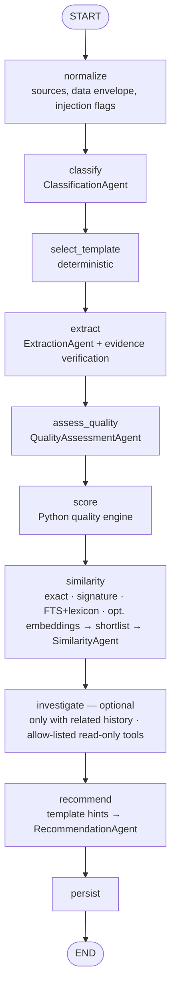

Details, guards and how to add a capability: [docs/agents.md](docs/agents.md).

## Screenshots

Captured from `make up LLM_MODE=mock` after `make sim-once`, `make seed` and `make seed-demo`, with
`make screenshots` ([`scripts/capture_screenshots.py`](scripts/capture_screenshots.py)). The UI is in
Turkish, as the branch staff use it.

**Canlı Akış (`/live`):** each LangGraph node as a card (robot = LLM agent, gear = deterministic step)
with its latest output and 24-hour statistics, and below it every finished analysis with its per-node
outcome strip (grey = skipped, for example `investigate` without related history).

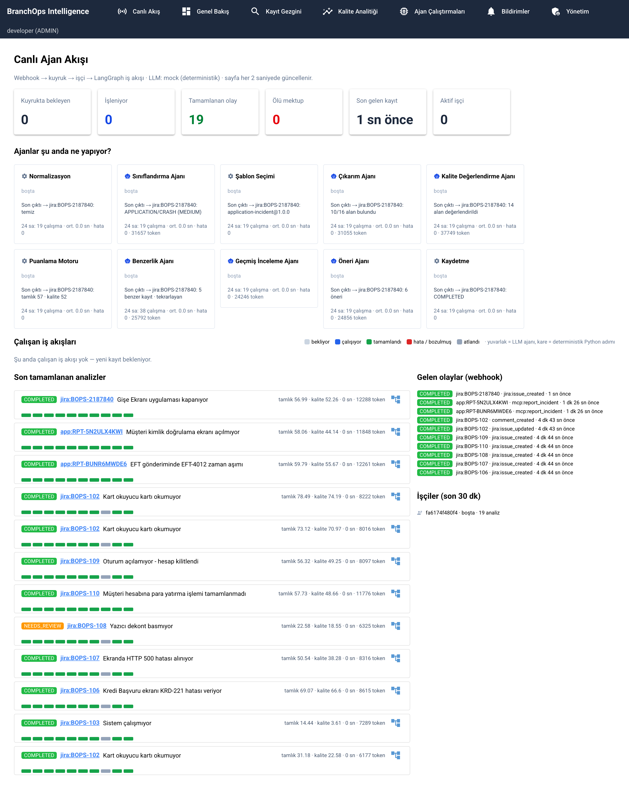

**Genel Bakış (`/`):** totals, average completeness and quality, low-quality and needs-review counts, the
daily trend and the category distribution.

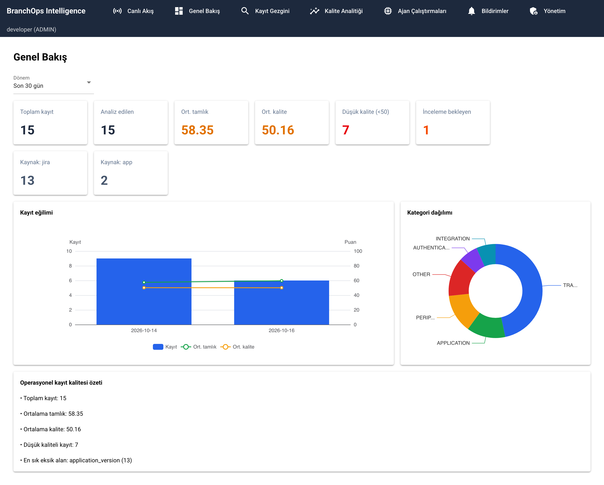

**Kayıt Gezgini (`/issues`):** every incident from Jira and in-app reports with category, branch,
completeness, quality and analysis status (`NEEDS_REVIEW` = the prompt-injection sample).

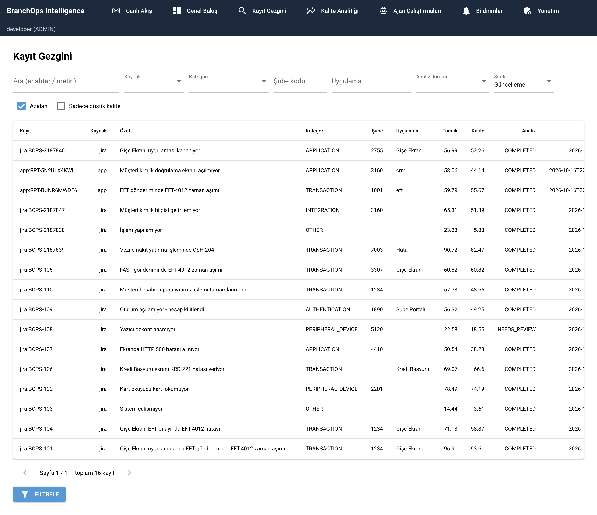

**Kayıt detayı (`/issues/<key>`):** one incident: per-field status, rubric level, source, verified
evidence and what is missing (Eksik) or insufficient (Yetersiz); tabs for recommendations, similar
incidents, app context, routing and score history.

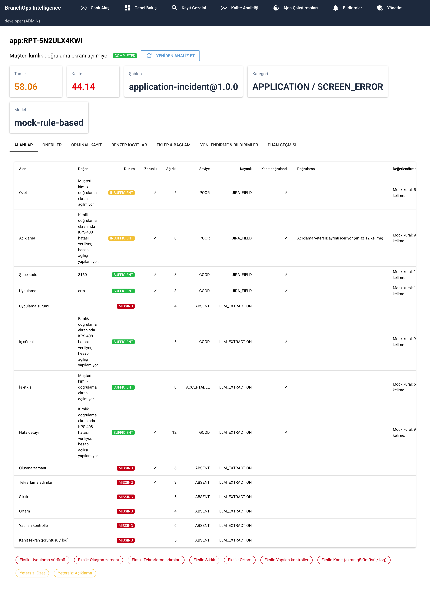

**Kalite Analitiği (`/analytics`):** routing KPIs, operational trends (UNKNOWN instead of 0 where the
source has no status history), missing fields per category, quality by branch, quality improvements after
updates and recurring error signatures.

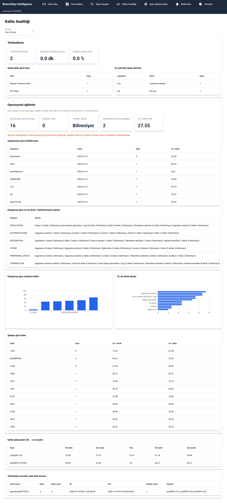

**Ajan Çalıştırmaları (`/executions`):** every workflow run with status, duration, model, template,
tokens, attempts and triggering event, plus the webhook inbox state.

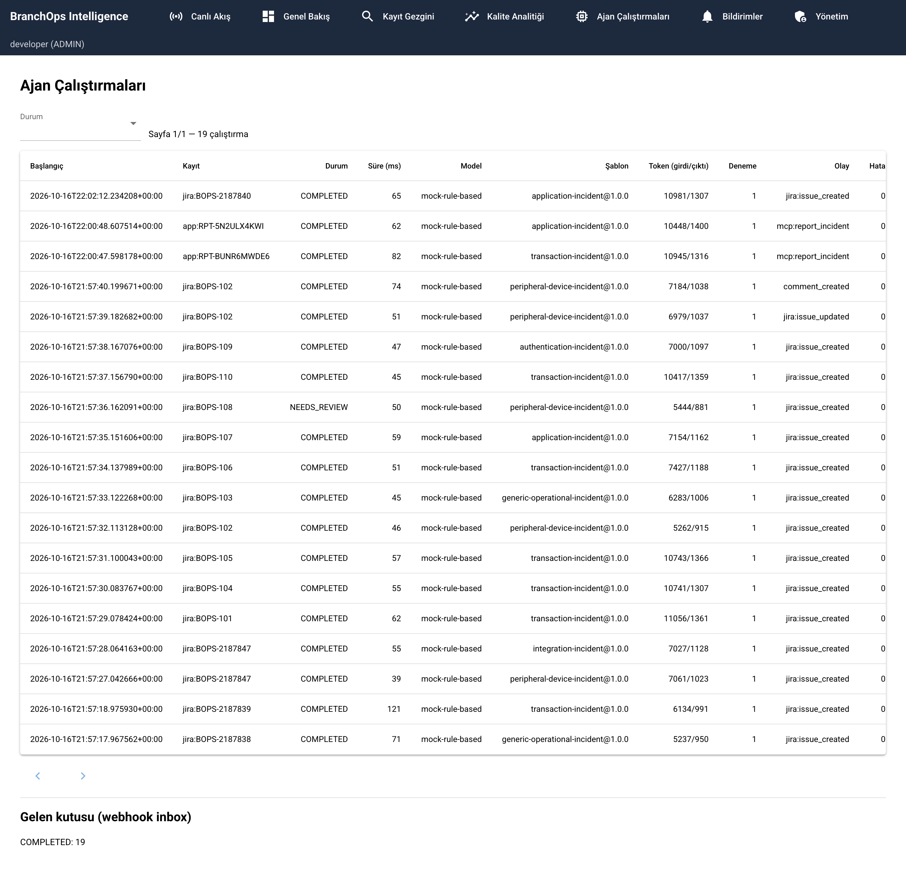

**Yönetim (`/yonetim`):** the ownership registry: teams, applications and screens, routing rules, "who
owns this?" and the change log.

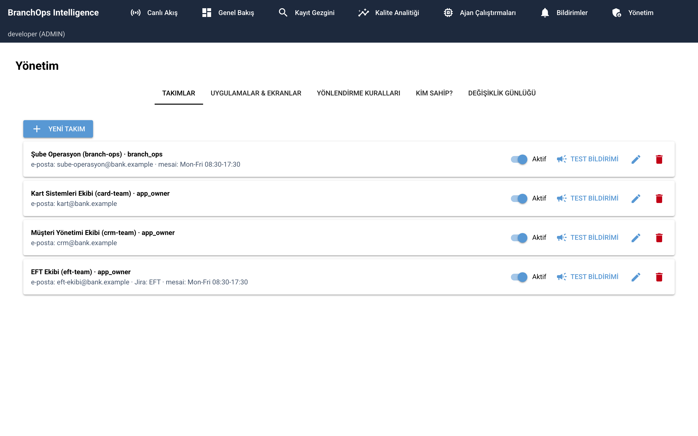

**Bildirimler (`/bildirimler`):** notifications sent through the outbox: owner team as To, branch
operations as CC, out-of-hours flag, status and resend.

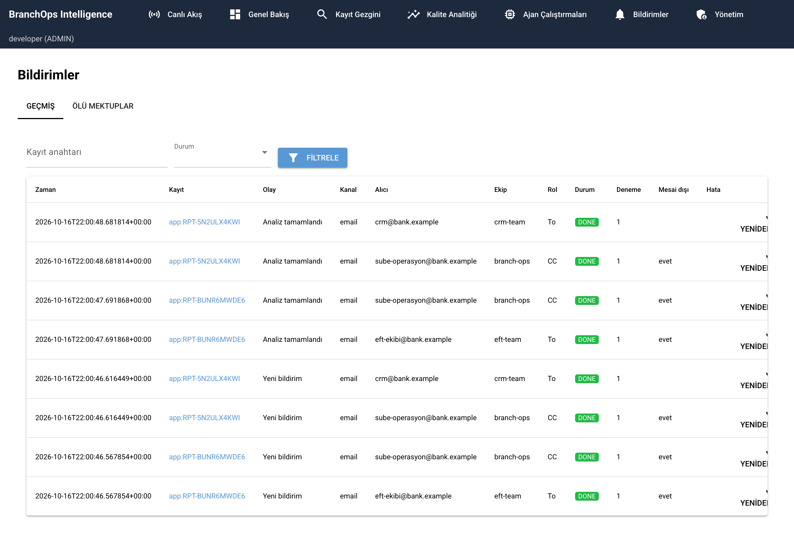

**MCP server:** `make mcp-health` and the catalogue other teams' MCP clients see: 17 tools, resources and
prompts ([`scripts/mcp_catalogue.py`](scripts/mcp_catalogue.py)).

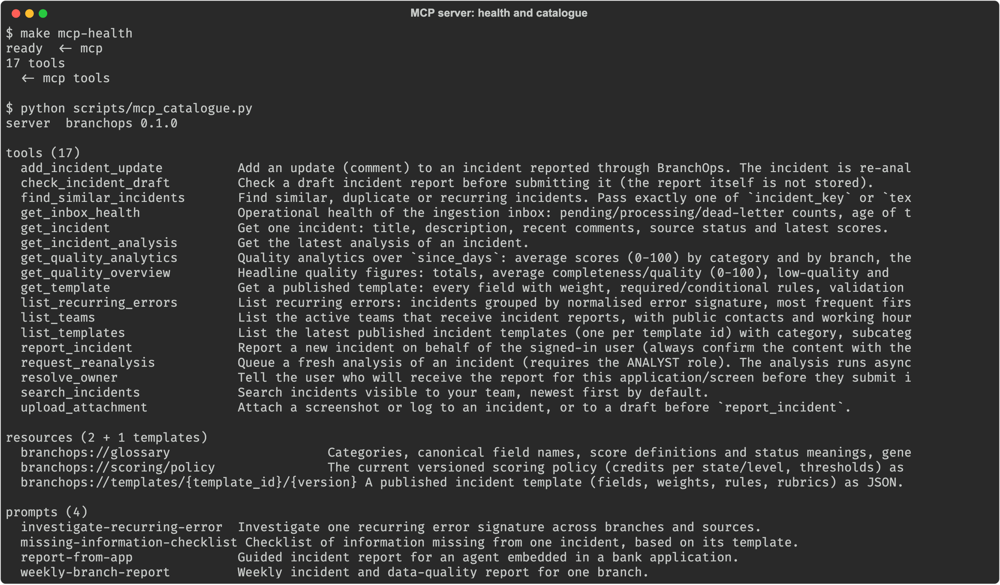

**`branchops report --days 30`:** the reporting agent's summary in mock mode; every number in the text
comes from the SQL metrics below it.

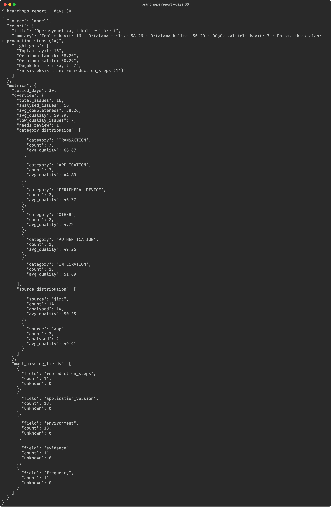

## Technologies

| Technology | Why |
|---|---|
| Python 3.12 | one language for API, workers, agents and dashboard; the bank's platform image |
| FastAPI | webhook and read API with typed validation, async request handling and OpenAPI |
| LangGraph + `PostgresSaver` | explicit, bounded agent graph with per-node retries and resumable checkpoints in the existing database |
| Pydantic | output schemas for every agent, context-aware validators, typed configuration |
| SQLAlchemy + Alembic | repositories behind ports, additive (expand/contract) migrations |
| PostgreSQL 17 (FTS `turkish`) | one store for inbox, data, checkpoints and retrieval; no extra vector database to operate |
| NiceGUI | internal dashboard in Python with no CDN assets (air-gapped) |
| FastMCP / MCP | lets other teams' assistants and in-app agents query and report incidents through audited, team-scoped tools |
| OpenAI-compatible client | one client for the internal gateway (target GLM-5.3-Flash) and vLLM (Qwen2.5-1.5B-Instruct for the laptop demo); no vendor lock-in |
| OpenTelemetry | metrics (Prometheus) and traces to the bank's internal collector only |
| Docker Compose | the whole stack, including the model server, with one `make up` |
| OpenShift | the bank's platform: non-root, read-only root filesystem, NetworkPolicies, oauth2-proxy SSO |
| ruff, mypy `--strict`, pytest | lint, strict typing and unit + PostgreSQL integration tests in CI |

## 5-minute demo

Needs only Docker (with Compose v2) and `make`. The first `make up` builds the image (a few minutes).

```bash
git clone https://github.com/mecitsemerci/branchops-intelligence.git
cd branchops-intelligence
cp .env.example .env                 # every variable is documented there; the defaults work as they are
make up LLM_MODE=mock                # postgres, api, worker, dashboard, mcp, simulator
make sim-once                        # post one random Turkish branch incident right now
open http://localhost:8090/live      # watch the agents work (xdg-open on Linux)
open http://localhost:8090/issues    # the analysed incidents; click one for the details
make down
```

`LLM_MODE=mock` uses a deterministic, keyword-based mock model, so an analysis finishes in well under a
second and the demo needs no GPU or model download. Plain `make up` runs a real model through vLLM in
Docker instead; on a laptop CPU that takes 6–11 minutes per analysis (see [Quick start](#quick-start)).
With Python 3.12 installed, `make seed` and `make seed-demo` add the fixed samples, teams and in-app
reports used for the screenshots.

## Secrets and configuration

All secrets come from the environment or a git-ignored `.env`; [`.env.example`](.env.example) documents
every variable. Configuration files contain only the *names* of the environment variables that hold
secrets, never their values, and BranchOps never writes secrets to the database or the logs. PII (TCKN, IBAN,
card numbers, phone numbers, e-mail addresses) is masked before storage and before the model sees any text
([security](docs/security.md)).

## Error handling

* **Invalid JSON from the model:** tolerant extraction, Pydantic validation, one bounded repair turn with
  the validation errors; after that the step falls back and the analysis is `PARTIAL`
  (`agents/base.py`, `workflows/issue_analysis.py`).
* **Model down:** transient errors go back to the durable inbox, which retries with exponential backoff
  and jitter (`workers/processor.py`). On the last attempt a provisional analysis is stored (`DEGRADED`
  steps), and the recovery scheduler re-analyses it once the model is healthy (`workers/recovery.py`).
* **Prompt injection:** Turkish and English detectors flag "ignore previous instructions"-style text and
  chat-template tokens; the analysis is set to `NEEDS_REVIEW`, and scores cannot be influenced because they
  are computed in Python (`domain/services/prompt_injection.py`).
* **Partial or out-of-order webhooks:** a per-attribute version vector merges partial updates and ignores
  stale ones; deletions are tombstones (`domain/services/snapshot_merge.py`).
* **Tool errors in `investigate`:** an invalid tool call (unknown incident key, missing argument) is
  returned to the model as an error result; an invalid model answer or an exhausted budget stores the
  investigation as `DEGRADED` / `BUDGET_EXHAUSTED` and the pipeline continues with recommendations
  (`agents/investigation.py`). A database failure retries the run, which resumes from its checkpoint.
* **Bad webhook signature:** `401`, nothing is stored, a warning log record and the `unauthorized` outcome
  metric (`api/routes/webhooks.py`, `infrastructure/security/webhook_auth.py`). Malformed or replayed
  payloads get `400` or are ignored, and a poison message ends in the dead-letter queue after
  `max_attempts`.

## Architecture

On-premise, Python-only agentic application that analyses operational incidents reported by bank branch
staff. Incidents arrive from several sources — Jira webhooks, ServiceNow Business Rule webhooks, CSV/XLSX/JSONL
imports — through per-source adapters into one source-neutral pipeline. It classifies and structures each incident with the bank's internal
LLM (preferred: **GLM-5.3-Flash** via an OpenAI-compatible gateway), maps it to a versioned template,
computes **deterministic** completeness and quality scores, recommends what information is missing,
detects similar and recurring incidents, and shows everything in an internal NiceGUI dashboard.

It runs entirely inside OpenShift without internet access: no cloud LLMs, no CDN assets, no runtime
package or model downloads, no external telemetry.

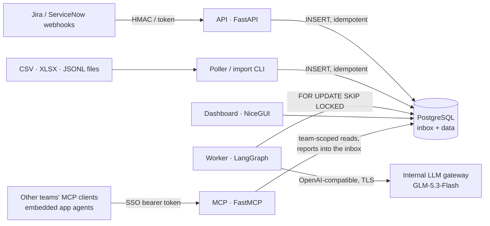

## Features

| Capability | Where |
|---|---|
| Source-agnostic ingestion: per-source adapters (Jira, ServiceNow reference, CSV/XLSX/JSONL) behind push/pull ports, `POST /api/ingest/{source}` | `application/interfaces/source_adapter.py`, `infrastructure/sources/`, [docs](docs/sources.md) |
| Authenticated webhook ingestion (HMAC `X-Hub-Signature`, header token, rotation, size limit, CIDR allow-list) | `api/routes/webhooks.py`, `infrastructure/security/webhook_auth.py` |
| Durable PostgreSQL inbox: idempotency, leases, retries with backoff, dead-letter, crash recovery | `infrastructure/persistence/inbox_repository.py`, `workers/` |
| Out-of-order / partial payload handling (per-attribute version vector, tombstones) | `domain/services/snapshot_merge.py` |
| Classification, extraction, quality assessment, similarity verification, recommendations, reporting agents; optional investigation agent with allow-listed read-only tools | `agents/` |
| Bounded LangGraph workflow with Postgres checkpoints, partial results and manual-review status | `workflows/issue_analysis.py` |
| Versioned, immutable JSON templates with conditions and rubrics (7 defaults) | `templates/`, `src/branchops/templates/` |
| Deterministic completeness & quality scoring with versioned policy | `scoring/` |
| Evidence verification (anti-hallucination), PII masking, prompt-injection flags | `domain/services/` |
| Similar / duplicate / recurring incidents (PostgreSQL FTS `turkish` + error signatures) | `agents/similarity.py`, `issue_repository.py` |
| Dashboard: overview, explorer, issue detail, quality analytics, agent executions, dead letters, live agent view (`/live`), ownership administration (`/yonetim`), notifications (`/bildirimler`) | `dashboard/` |
| In-app incident reporting via MCP: app context, screenshots (re-encoded, blurred, never sent to the LLM), draft check, Jira ticket outbox | `mcp/reporting.py`, `application/commands/`, [docs](docs/embedded-agent-guide.md) |
| Screen ownership registry managed in the dashboard (`/yonetim`), deterministic owner routing, e-mail / Zoom notifications through an outbox (branch operations always CC) | `domain/entities/ownership.py`, `application/commands/routing.py`, [docs](docs/ownership-and-routing.md) |
| MCP server (read-mostly: queries plus in-app incident reporting and re-analysis requests) for other teams (Claude, Cursor, chatbots): team-scoped tools, resources, prompts; audited | `mcp/`, [docs](docs/mcp-server.md) |
| Offline evaluation of models, templates and scoring (record/replay, multi-model comparison, score calibration against expert labels) | `evaluation/`, [docs](docs/evaluation.md) |
| Model outage recovery (provisional analyses, bounded idempotent re-analysis when the model returns) | `workers/recovery.py`, [docs](docs/model-integration.md#model-outages-and-recovery) |
| Operational analytics: application/branch/category trends, missing fields per category, quality after updates, reopen and recurrence after resolution (UNKNOWN when the source gives no status history) | `application/queries/operations.py`, [docs](docs/operational-analytics.md) |
| OpenTelemetry metrics (Prometheus) and traces (internal OTLP only) | `infrastructure/observability/` |
| OpenShift manifests: non-root, read-only FS, probes, NetworkPolicies, HPA, oauth2-proxy SSO | `deploy/openshift/` |

## Quick start

Requirements: Docker with Compose v2, GNU make, Python 3.12 (only for `make seed` and the virtualenv
targets). `make help` lists every target.

### Full stack in Docker — vLLM agents + simulated Jira traffic

```bash
make up                      # model in the vllm compose service + random incidents every 5 minutes
open http://localhost:8090/live   # live agent view: who is doing what, workflow diagram per run
make sim-once                # one more random incident right now
make logs SERVICE=worker     # (SERVICE=vllm for the model server)
make down                    # stop (make clean-docker also deletes the database and model cache volumes)
```

| LLM_MODE | Model server | Notes |
|---|---|---|
| `docker` (default) | `vllm` compose service (profile `vllm`), `http://vllm:8000/v1` | CPU image `vllm/vllm-openai-cpu` (amd64/arm64) by default; `VLLM_DEVICE=gpu` switches to the CUDA image on NVIDIA GPUs (`deploy/docker/compose.gpu.yaml`) |
| `host` | an OpenAI-compatible server on this machine, `http://host.docker.internal:8000/v1` (`HOST_LLM_PORT`) | e.g. `vllm serve <model>`; set `LLM_MODEL` to its model name |
| `mock` | none | deterministic keyword rules, for offline/CI |

The model is `VLLM_MODEL` (default `Qwen/Qwen2.5-1.5B-Instruct`, Apache-2.0, not gated), served with a
16k context (`VLLM_MAX_MODEL_LEN`, equal to `llm.capabilities.context_length`), JSON-schema structured
outputs and temperature 0. `make up` first starts `vllm` and waits until the model is loaded: the first
run downloads the image and the model (about 3 GB each) into the `vllm-cache` volume, later starts take
under a minute. The endpoint is also published on `127.0.0.1:8099` (`VLLM_PORT`) for evaluations from the
host. Other models: set `VLLM_MODEL` in `.env` (gated models also need `HF_TOKEN`); see `.env.example`.

On CPU the default model needs about 6 GB of Docker memory (weights, 1 GiB KV cache, runtime); with the
rest of the stack plan for 8 GB, and more for larger models. CPU inference is slow: on an Apple M3 Pro
(Docker, 8 vCPU, no Metal) it decodes about 6–7 tokens/s and one analysis takes 6–11 minutes, so set
`SIMULATOR_INTERVAL_SECONDS=900` in `.env` there, or use a GPU host. The 1.5B model keeps the stack
runnable on a laptop and its structured output is always valid, but its classification is weak (a
3-case live evaluation put every case in TRANSACTION); use a larger `VLLM_MODEL` when quality matters.

`make up LLM_MODE=host` / `make up LLM_MODE=mock` switch modes. The **simulator** service posts a
random Turkish branch incident every `SIMULATOR_INTERVAL_SECONDS` (default 300 s, ±10 % jitter) after a
burst of `SIMULATOR_INITIAL_BURST` (default 2) — mixed categories, complete/partial/vague profiles,
near-duplicates, recurring error codes and follow-up comments that add missing information (so score
improvements appear). `make sim-stop` / `make sim-start` pause and resume it.

The **Canlı Akış** (`/live`) page refreshes every 2 seconds and shows:
queue/worker KPIs; one card per workflow node (LLM agents and deterministic steps) with the issue it is
working on, the worker, elapsed time, its latest output and 24 h statistics; a LangGraph diagram per
running analysis with node states (waiting / running / done / failed / skipped); recently finished
analyses with their per-node outcome strip and a diagram + step table on demand; incoming webhook events
and active workers.

Other targets: `make seed` (fixed samples), `make seed-demo` (samples plus demo teams, screens and in-app
reports), `make screenshots` (README images; once: `.venv/bin/playwright install chromium`), `make overview`,
`make up WORKERS=3`, `make health`.

| Service | URL / port | Notes |
|---|---|---|
| api | http://localhost:8080 | `/api/webhooks/jira`, `/api/*`, `/health/*`, `/metrics` |
| dashboard | http://localhost:8090 | dev auth (ADMIN) |
| mcp | http://localhost:8095/mcp | MCP server (read-mostly: queries plus in-app incident reporting and re-analysis requests), dev auth (`make mcp-health`) |
| worker | :8081 inside the container | `/healthz`, `/readyz`, `/metrics` (`make health`) |
| simulator | — | posts random incidents to the api (`simulate` command) |
| vllm | 127.0.0.1:8099 | OpenAI-compatible model server (`/v1/models`, `/health`, `/metrics`); `make llm-health` |
| postgres | localhost:55432 | `branchops/branchops`, databases `branchops` and `branchops_test` |

The containers run like on OpenShift: arbitrary non-root UID in group 0, read-only root filesystem,
writable `/tmp` only, all capabilities dropped. Configuration: `config/docker.yaml`; overrides via `.env`
(see `.env.example`). Any other OpenAI-compatible endpoint works the same way: set `LLM_BASE_URL`,
`LLM_MODEL`, `LLM_API_KEY` in `.env` and check with `make llm-health`. The vLLM service and its model
download are a developer-laptop convenience; in the bank the worker uses the internal inference gateway.

The compose build uses the same Dockerfile as production with `WHEELHOUSE_SOURCE=online` (packages from
`PIP_INDEX_URL`, default PyPI; point it at your mirror inside the bank). Production builds use
`make wheelhouse image` (offline, see [OpenShift deployment](docs/openshift-deployment.md)).

### Virtualenv workflow

```bash
make install     # .venv + project + dev tools
make db          # only PostgreSQL from compose
BRANCHOPS_CONFIG=config/local.yaml .venv/bin/branchops migrate
make run-api     # / make run-worker / make run-dashboard / make run-mcp  (config/local.yaml, mock model)
make check       # ruff + mypy --strict + all tests (unit + PostgreSQL integration)
```

## Commands

| Command | Purpose |
|---|---|
| `branchops api` | FastAPI app (`/api/ingest/{source}`, `/api/webhooks/jira`, read API, `/health/*`, `/metrics`) |
| `branchops worker` | Inbox worker; also drains the ticketing and notification outboxes and purges old attachments (`/healthz`, `/readyz`, `/metrics` on `worker.health_port`) |
| `branchops ownership check` | Validate the screen ownership registry (exit 1 on errors) |
| `branchops attachments purge` | Apply `retention.attachments_days` now |
| `branchops import --source csv <file>` | Import a CSV/XLSX/JSONL file through a file-based source (`--dry-run` validates only) |
| `branchops poll [--source id] [--once]` | Read pull sources on their schedule; one leader across replicas (advisory lock) |
| `branchops dashboard` | NiceGUI dashboard |
| `branchops mcp [--stdio]` | MCP server (read-mostly: queries plus in-app incident reporting and re-analysis requests) (streamable HTTP on `mcp.host:port/mcp`; `--stdio` for local development only) |
| `branchops migrate` | DB migrations, checkpoint tables, template publication (immutability check) |
| `branchops templates` | Validate and list templates |
| `branchops llm health\|probe` | Model gateway health / capability detection |
| `branchops replay <event-id>` | Requeue a dead-lettered inbox event |
| `branchops simulate [--once] [--burst N]` | Development/demo only: posts random synthetic incidents to the API (used by the compose `simulator` service; `--once` sends the burst and exits) |
| `branchops eval run\|compare\|calibrate` | Offline evaluation over a labelled dataset (`--provider mock\|replay\|live`, `--record` for reproducible replays); see [evaluation](docs/evaluation.md) |
| `branchops recover [--incident KEY]` | One recovery tick: re-analyse incidents degraded by a model outage (the worker does this every minute) |
| `branchops inbox purge` | Apply `retention.inbox_days` / `inbox_dead_letter_days` now |
| `branchops report --days 30` | Model-written operational summary (numbers grounded in SQL metrics) |

## Tests

```bash
make test-unit   # no database, no model
make test        # + PostgreSQL integration / API / end-to-end (uses compose postgres, branchops_test DB)
make test-llm    # optional smoke tests against the real internal endpoint
make lint typecheck
```

CI ([`.github/workflows/ci.yml`](.github/workflows/ci.yml)) runs lint, strict mypy, the unit and PostgreSQL
suites on Python 3.12 and 3.13, and renders the OpenShift manifests. It uses the mock provider; no model
endpoint is needed. The PostgreSQL suite drops and recreates the
`public` schema of `TEST_DATABASE_URL` — always point it at a dedicated database.

## Documentation

* [Architecture](docs/architecture.md) — layering, processes, decisions
* [Agents](docs/agents.md) — logical agents, guardrails, adding capabilities
* [Incident sources](docs/sources.md) — source model, configuration, ServiceNow and CSV/XLSX adapters, adding a source
* [Jira integration](docs/jira-integration.md) — webhook setup, payload variants, ordering, retention
* [Templates](docs/templates.md) — template format and how to add one
* [Scoring](docs/scoring.md) — completeness/quality formulas and policies
* [Model integration](docs/model-integration.md) — gateway configuration, capabilities, fallbacks
* [MCP server](docs/mcp-server.md) — connecting MCP clients, team scopes, tool catalogue, audit
* [Ownership and routing](docs/ownership-and-routing.md) — teams/applications/screens, resolution order, notifications, dashboard how-to, CSV
* [Embedded agent guide](docs/embedded-agent-guide.md) — reporting from inside a bank application with app context and screenshots
* [Security](docs/security.md) — controls and threat model
* [OpenShift deployment](docs/openshift-deployment.md) — offline build and deployment
* [Evaluation](docs/evaluation.md) — test strategy, evaluation framework, score calibration
* [Operational analytics](docs/operational-analytics.md) — trends, reopen and recurrence, data coverage
* [Architecture gap analysis](docs/architecture-gap-analysis.md) — audit findings and their status
* [Implementation report](docs/implementation-report.md) — what was implemented, tested, and what remains

## Assumptions and limitations

* **Jira *ingestion* is webhook-only** (no backfill of historical issues; a CSV export can be imported
  through a `csv_import` source instead). The only outbound Jira access is the optional ticketing sink
  (`ticketing.sink: jira`) that opens tickets for incidents reported through MCP. An issue first seen through a partial update without summary/description
  is stored but not analysed until a fuller payload arrives.
* **Model capabilities are configured, not guessed.** The default assumes JSON-object mode only;
  enable `structured_outputs` (JSON schema) after `branchops llm probe` confirms it.
* **Tool calling is confined to the optional `investigate` step** (`agents/investigation.py`). There the
  model may call five allow-listed, read-only tools (`search_history`, `get_issue_summary`,
  `issue_metadata`, `compare_error_signatures`, `known_resolutions`) within a bounded budget (tool calls,
  turns, seconds, tokens), and only when related history exists. The tool choice is a schema enum in
  the structured output, so no native function-calling support is needed (`capabilities.tool_calling`
  stays `false`). All other agents are structured-output only by design: they receive data, never tools.
* **Similarity uses PostgreSQL full-text search** (`turkish` configuration) plus deterministic error
  signatures and a Turkish domain lexicon. Embedding retrieval is optional and off by default
  (`workflow.similarity.embeddings`, an approved internal embedding endpoint, vectors in PostgreSQL
  `REAL[]`, no pgvector); without it, retrieval falls back to full-text search.
* **The mock provider is a development aid**, not a model: its classifications are keyword-based.
  Quality of real analyses depends on the internal model and must be evaluated with
  `docs/evaluation.md` before go-live.
* **The API never calls the model.** `/api/reports/summary` and the dashboard show deterministic
  report text; model-written narratives are produced by `branchops report` (worker-side credentials).
* **SSO** is delegated to an oauth2-proxy sidecar against the bank's OIDC IdP (groups → roles). Direct
  LDAP/Kerberos integration is not implemented.
* **Recurrence** requires an error code in the error details (signature = application + first code);
  incidents without codes are linked only through verified similarity relationships.
* An analysis made while the model was unavailable is stored as provisional (`DEGRADED` steps) and
  re-analysed automatically by the recovery scheduler once the model is healthy again
  ([model integration](docs/model-integration.md#model-outages-and-recovery)). Analyses that are
  `PARTIAL` for other reasons (invalid output after repair) are not retried; use manual re-analysis.
* The dashboard keeps UI state per process; run one replica or rely on Route session affinity.
* Turkish is the primary data language; prompts are English with explicit instructions to keep
  values in the original language.
