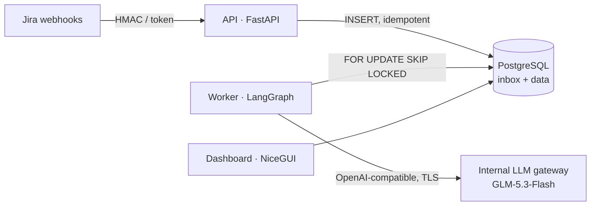

# BranchOps Intelligence

On-premise, Python-only agentic application that analyses Jira operational incidents created by bank
branch staff. It receives Jira webhooks, classifies and structures each incident with the bank's internal
LLM (preferred: **GLM-5.3-Flash** via an OpenAI-compatible gateway), maps it to a versioned template,
computes **deterministic** completeness and quality scores, recommends what information is missing,
detects similar and recurring incidents, and shows everything in an internal NiceGUI dashboard.

It runs entirely inside OpenShift without internet access: no cloud LLMs, no CDN assets, no runtime
package or model downloads, no external telemetry.



## Features

| Capability | Where |
|---|---|
| Authenticated webhook ingestion (HMAC `X-Hub-Signature`, header token, rotation, size limit, CIDR allow-list) | `api/routes/webhooks.py`, `infrastructure/security/webhook_auth.py` |
| Durable PostgreSQL inbox: idempotency, leases, retries with backoff, dead-letter, crash recovery | `infrastructure/persistence/inbox_repository.py`, `workers/` |
| Out-of-order / partial payload handling (per-attribute version vector, tombstones) | `domain/services/snapshot_merge.py` |
| Classification, extraction, quality assessment, similarity verification, recommendations, reporting agents | `agents/` |
| Bounded LangGraph workflow with Postgres checkpoints, partial results and manual-review status | `workflows/issue_analysis.py` |
| Versioned, immutable JSON templates with conditions and rubrics (7 defaults) | `templates/`, `src/branchops/templates/` |
| Deterministic completeness & quality scoring with versioned policy | `scoring/` |
| Evidence verification (anti-hallucination), PII masking, prompt-injection flags | `domain/services/` |
| Similar / duplicate / recurring incidents (PostgreSQL FTS `turkish` + error signatures) | `agents/similarity.py`, `issue_repository.py` |
| Dashboard: overview, explorer, issue detail, quality analytics, agent executions, dead letters | `dashboard/` |
| OpenTelemetry metrics (Prometheus) and traces (internal OTLP only) | `infrastructure/observability/` |
| OpenShift manifests: non-root, read-only FS, probes, NetworkPolicies, HPA, oauth2-proxy SSO | `deploy/openshift/` |

## Quick start

Requirements: Docker with Compose v2, GNU make, Python 3.12 (only for `make seed` and the virtualenv
targets). `make help` lists every target.

### Full stack in Docker

```bash
make up          # build the image, start postgres → migrate → api, worker, dashboard (waits for health)
make seed        # send signed synthetic Turkish Jira webhooks (samples/jira)
make overview    # analytics from the API
open http://localhost:8090   # dashboard
make logs SERVICE=worker
make up WORKERS=3            # scale workers
make down                    # stop (make clean-docker also deletes the database volume)
```

| Service | URL / port | Notes |
|---|---|---|
| api | http://localhost:8080 | `/api/webhooks/jira`, `/api/*`, `/health/*`, `/metrics` |
| dashboard | http://localhost:8090 | dev auth (ADMIN) |
| worker | :8081 inside the container | `/healthz`, `/readyz`, `/metrics` (`make health`) |
| postgres | localhost:55432 | `branchops/branchops`, databases `branchops` and `branchops_test` |

The containers run like on OpenShift: arbitrary non-root UID in group 0, read-only root filesystem,
writable `/tmp` only, all capabilities dropped. Configuration: `config/docker.yaml`; overrides via `.env`
(see `.env.example`). The default model provider is the deterministic **mock**; to use a real
OpenAI-compatible endpoint set `LLM_PROVIDER=openai-compatible`, `LLM_BASE_URL`, `LLM_MODEL`,
`LLM_API_KEY` in `.env`, run `make up` and check with `make llm-health`.

The compose build uses the same Dockerfile as production with `WHEELHOUSE_SOURCE=online` (packages from
`PIP_INDEX_URL`, default PyPI; point it at your mirror inside the bank). Production builds use
`make wheelhouse image` (offline, see [OpenShift deployment](docs/openshift-deployment.md)).

### Virtualenv workflow

```bash
make install     # .venv + project + dev tools
make db          # only PostgreSQL from compose
BRANCHOPS_CONFIG=config/local.yaml .venv/bin/branchops migrate
make run-api     # / make run-worker / make run-dashboard  (config/local.yaml, mock model)
make check       # ruff + mypy --strict + all tests (unit + PostgreSQL integration)
```

## Commands

| Command | Purpose |
|---|---|
| `branchops api` | FastAPI app (webhooks, read API, `/health/*`, `/metrics`) |
| `branchops worker` | Inbox worker (`/healthz`, `/readyz`, `/metrics` on `worker.health_port`) |
| `branchops dashboard` | NiceGUI dashboard |
| `branchops migrate` | DB migrations, checkpoint tables, template publication (immutability check) |
| `branchops templates` | Validate and list templates |
| `branchops llm health\|probe` | Model gateway health / capability detection |
| `branchops replay <event-id>` | Requeue a dead-lettered inbox event |
| `branchops report --days 30` | Model-written operational summary (numbers grounded in SQL metrics) |

## Tests

```bash
make test-unit   # no database, no model
make test        # + PostgreSQL integration / API / end-to-end (uses compose postgres, branchops_test DB)
make test-llm    # optional smoke tests against the real internal endpoint
make lint typecheck
```

CI uses the mock provider; no model endpoint is needed. The PostgreSQL suite drops and recreates the
`public` schema of `TEST_DATABASE_URL` — always point it at a dedicated database.

## Documentation

* [Architecture](docs/architecture.md) — layering, processes, decisions
* [Agents](docs/agents.md) — logical agents, guardrails, adding capabilities
* [Jira integration](docs/jira-integration.md) — webhook setup, payload variants, ordering, retention
* [Templates](docs/templates.md) — template format and how to add one
* [Scoring](docs/scoring.md) — completeness/quality formulas and policies
* [Model integration](docs/model-integration.md) — gateway configuration, capabilities, fallbacks
* [Security](docs/security.md) — controls and threat model
* [OpenShift deployment](docs/openshift-deployment.md) — offline build and deployment
* [Evaluation](docs/evaluation.md) — test strategy, synthetic data, model evaluation

## Assumptions and limitations

* **Jira access is webhook-only.** Historical issues that never produced a webhook are not known to the
  system; there is no backfill. An issue first seen through a partial update without summary/description
  is stored but not analysed until a fuller payload arrives.
* **Model capabilities are configured, not guessed.** The default assumes JSON-object mode only;
  enable `structured_outputs` (JSON schema) after `branchops llm probe` confirms it. Tool calling is never
  used.
* **Similarity uses PostgreSQL full-text search** (`turkish` configuration) plus deterministic error
  signatures. pgvector / embedding retrieval is not implemented (the optional internal embedding model
  was not specified); the `HistoricalIssueReader` port is where it would plug in.
* **The mock provider is a development aid**, not a model: its classifications are keyword-based.
  Quality of real analyses depends on the internal model and must be evaluated with
  `docs/evaluation.md` before go-live.
* **The API never calls the model.** `/api/reports/summary` and the dashboard show deterministic
  report text; model-written narratives are produced by `branchops report` (worker-side credentials).
* **SSO** is delegated to an oauth2-proxy sidecar against the bank's OIDC IdP (groups → roles). Direct
  LDAP/Kerberos integration is not implemented.
* **Recurrence** requires an error code in the error details (signature = application + first code);
  incidents without codes are linked only through verified similarity relationships.
* An analysis persisted as `PARTIAL` after the model was unavailable on the last attempt is not retried
  automatically (its input hash is recorded); use manual re-analysis once the model is back.
* The dashboard keeps UI state per process; run one replica or rely on Route session affinity.
* Turkish is the primary data language; prompts are English with explicit instructions to keep
  values in the original language.
