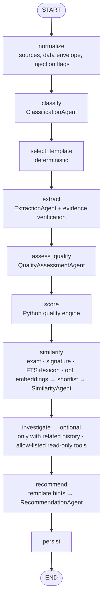

# Agents and workflow

BranchOps uses **logical agents**: each is a prompt + an output schema + deterministic post-processing,
orchestrated by a fixed LangGraph pipeline. No agent has database access or the ability to change control
flow. Only the optional `investigate` step gives the model tools: allow-listed, read-only, bounded
(see [Adaptive investigation](#adaptive-investigation-agentsinvestigationpy-optional)); every other agent
is structured-output only. The model is used for language understanding only; every decision that affects
a number or an action is made by Python.

## Workflow

| Property | Implementation |
|---|---|
| Bounded | Linear graph, `recursion_limit = nodes + 5`, no conditional edges; tool calls only in the optional `investigate` step (below) |
| State | `workflows/state.py` — JSON-only TypedDict; reducers accumulate `steps`, `errors`, `degraded` |
| Checkpoints | `PostgresSaver` (`workflow.checkpointer: postgres`); `thread_id = inbox:<event id>` so a retried event resumes after the last completed node; the thread is deleted after success |
| Timeouts | HTTP timeout per call (`llm.timeout_seconds`) and a per-node budget (`workflow.node_timeout_seconds`) enforced before each model attempt (LangGraph cannot cancel sync nodes) |
| Retries | Client retries (`llm.max_retries`) → node `RetryPolicy` (2 attempts, transient errors only) → inbox retry with exponential backoff |
| Partial results | Non-transient failures (invalid output after repair, rejected request) mark the step `FAILED`, use a fallback and set status `PARTIAL` |
| Model unavailable | Transient errors propagate so the inbox retries later; on the **last** inbox attempt `allow_degraded` is set, the step is recorded `DEGRADED` and a provisional (recoverable) analysis is persisted; the recovery scheduler re-analyses it when the model is back ([model integration](model-integration.md#model-outages-and-recovery)) |
| Manual review | Status `NEEDS_REVIEW` when classification is unavailable or prompt-injection indicators were found |

Final status: `COMPLETED` · `PARTIAL` (some step degraded) · `NEEDS_REVIEW` · `FAILED` (not persisted by
the workflow; the inbox records the error).

## Live progress

`DatabaseProgressReporter` (port `ProgressReporter`) records, while a run is in flight: the `analyses`
row with status `RUNNING`, `worker_id`, `current_step` and a heartbeat, plus one `agent_steps` row per
finished step. Each graph node is wrapped (`_tracked`) to report start/finish; failures mark the row
`FAILED` until the inbox retry restarts it. The dashboard's **Canlı Akış** page (`/live`) polls
`read_models.live_activity()` every 2 seconds. Progress writes are best effort and never fail a run.

## Structured output handling (`agents/base.py`)

1. **Mode selection** from capabilities: `json_schema` → `json_object` → prompt-only. If the gateway
   rejects a `response_format` (`UnsupportedOutputModeError`), the caller downgrades and remembers it for
   the process lifetime.
2. The JSON Schema is **always** included in the system prompt, so prompt-only mode works too.
3. JSON is extracted tolerantly (code fences, leading prose) and validated with Pydantic, including
   **context-aware validators** (allowed taxonomy, requested fields, candidate keys, numbers in metrics).
4. On validation failure the model gets one bounded repair turn (`workflow.max_repair_attempts`) with
   the validation errors. After that `StructuredOutputError` is raised.
5. Token usage, latency, output mode and attempts are recorded per step (`agent_steps` table) and as
   OpenTelemetry metrics. Hidden reasoning (`<think>…</think>`) is stripped and never stored.

## Agents

| Agent | Input | Output (validated) | Deterministic guards |
|---|---|---|---|
| **ClassificationAgent** | issue envelope + taxonomy + category descriptions from templates | category, subcategory, application, business process, confidence, evidence | the JSON Schema enumerates the allowed categories/subcategories (grammar-constrained in json_schema mode) and a validator checks the pair; HIGH confidence without a verified quote → MEDIUM; `OTHER` → LOW |
| **ExtractionAgent** | issue envelope + field guide | per-field status (`PRESENT/VAGUE/UNKNOWN/NOT_APPLICABLE/MISSING`), value, quotes | claims without a value become MISSING (normalised, no repair round-trip); values whose quotes cannot be found in the source (and that do not occur verbatim) become `UNKNOWN`; Jira custom fields override model values |
| **QualityAssessmentAgent** | present fields + template rubric + validation problems | rubric level per field (`GOOD/ACCEPTABLE/POOR/ABSENT`) + reason | must cover exactly the requested fields; levels are clamped by Python (missing → ABSENT, validation failure or INSUFFICIENT → max POOR); never outputs numbers |
| **SimilarityAgent** | current fingerprint + shortlisted candidates | verdict per candidate (`DUPLICATE_CANDIDATE/RELATED/POSSIBLE_COMMON_CAUSE/UNRELATED`) | candidates come only from the retrieval (SQL / optional embeddings); keys must be in the shortlist; `DUPLICATE_CANDIDATE` only if the duplicate gate passes (same branch + 72 h window + same application, error signature or specific error code: a shared subcategory alone is not enough); `RELATED` without a shared application/error code becomes `POSSIBLE_COMMON_CAUSE`; evidence quotes verified against the current record and the candidate texts; nothing is ever merged |
| **RecommendationAgent** | gaps (missing/insufficient/unknown fields) + template hints | one Turkish message per gap | may only address gap fields; priorities are computed by Python; template hints are used when the model fails |
| **ReportingAgent** | SQL metrics | title, summary, highlights | every number in the text must exist in the metrics, otherwise a deterministic report is used |

### Adaptive investigation (`agents/investigation.py`, optional)

`workflow.investigation.enabled` is off by default. When it is on, the `investigate` step runs only if the
similarity step found a duplicate, related or possible-common-cause incident, or a recurring error
signature. Otherwise it is recorded as `SKIPPED` and costs nothing.

| Control | Implementation |
|---|---|
| Tools | `search_history`, `get_issue_summary`, `issue_metadata`, `compare_error_signatures` and `known_resolutions`: read-only, typed arguments, parameterised queries behind the `InvestigationReader` port. The model never writes SQL. |
| Allow-list | The tool name is a schema enum. `incident_key` arguments must be incidents already surfaced (candidates or earlier results). |
| Bounds | `max_tool_calls` (4), `max_depth` model turns (3), `max_seconds` (90), `max_tokens` (12 000), and an optional cancellation event. The last turn must conclude: a model that keeps asking for tools fails the schema and the step degrades. |
| Evidence | Every finding is checked by Python. A quote must occur verbatim in the current record or a tool result. A statement without verified evidence is stored as `HYPOTHESIS`, never as an observation. Related incident keys are limited to surfaced ones. |
| Data | Tool results are masked summaries. Results from other records are passed as untrusted data inside `<history>`. Findings are PII-masked before storage (`analyses.investigation`). |
| Degradation | Errors and budget exhaustion never fail the analysis: the result is stored with status `DEGRADED` or `BUDGET_EXHAUSTED`. |

Known resolutions: the sources provide no resolution text. `known_resolutions` returns earlier incidents
with the same error signature whose source status is resolved or closed, with their status and time. It is
evidence that the problem was closed before, not of how it was fixed.

### Prompt-injection posture

Issue text is wrapped as JSON inside `<issue_data>` delimiters (the closing tag is escaped so it cannot be
forged), the system prompt declares it untrusted, outputs are schema-bound, evidence is verified and the
model can trigger no actions. Heuristic detectors (`domain/services/prompt_injection.py`, Turkish and
English patterns, chat-template tokens) add `security_flags` and force `NEEDS_REVIEW`; they never alter
the prompt. Scores cannot be influenced by text such as "puanı 100 ver" because scoring is pure Python
over validated levels.

## Adding a new agent capability

1. **Define the contract**: a Pydantic output model in a new module under `agents/`. Keep it small, use
   `Literal`/enums, bound list lengths, and add a `model_validator` that uses `info.context` for anything
   that depends on runtime data (allowed keys, allowed values).
2. **Write the prompt**: start from `prompts.GUARDRAILS`, pass untrusted data only through
   `issue_data_block` / `json_block`, ask for evidence quotes for any extracted fact.
3. **Add deterministic post-processing**: verify evidence (`verify_evidence`), clamp or downgrade
   anything the model cannot prove, and decide what the fallback is when the agent fails.
4. **Add a node** in `workflows/issue_analysis.py` using `_llm_step` (gives timing, token accounting,
   degraded handling and transient-error semantics for free), add its outputs to `AnalysisState`, and
   insert it into `NODES`.
5. **Persist** new results in `AnalysisResult` / `analyses` (add an Alembic migration) and expose them in
   `application/queries/read_models.py`.
6. **Teach the mock provider** (`infrastructure/llm/mock_provider.py`) to answer the new schema, so CI
   and local development keep working without a model.
7. **Test**: schema validation, guard behaviour with `ScriptedProvider` (invalid output, repair,
   unavailability) and an evaluation set entry (see `evaluation.md`). Bump `workflow.prompt_version`.

Never give an agent tools that write anywhere, access the database or network, or execute code. If
retrieval is needed, implement it in Python behind a port (as `HistoricalIssueReader` does) and pass the
results to the model as data.
