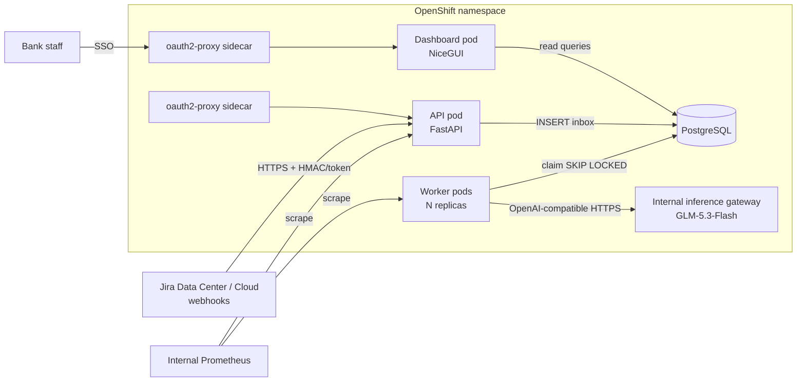
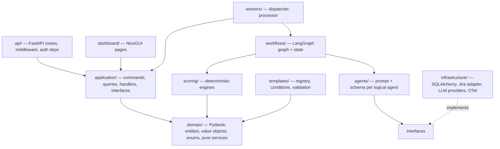
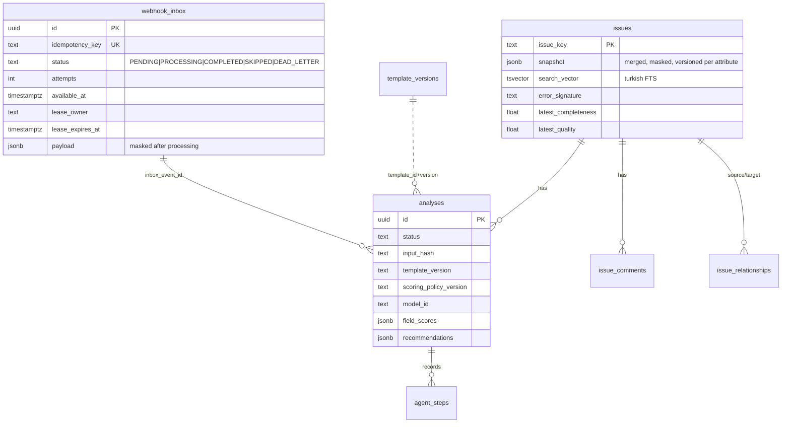

# Architecture

BranchOps Intelligence is a **modular monolith**: one Python code base (`src/branchops`) deployed as three
processes that share the same domain, application and infrastructure layers.

| Process   | Entry point                 | Responsibility                                                     |
|-----------|-----------------------------|--------------------------------------------------------------------|
| API       | `branchops api`             | Jira webhook ingestion, read API, health probes, `/metrics`         |
| Worker    | `branchops worker`          | Claims inbox events, merges issue state, runs the analysis workflow |
| Dashboard | `branchops dashboard`       | NiceGUI operational dashboard (read-only + re-analysis requests)    |

All three talk to a single PostgreSQL database. There is no message broker: PostgreSQL is the durable
inbox and the job-coordination mechanism (`FOR UPDATE SKIP LOCKED` + leases).



## Layering



Rules enforced by convention and review:

* `domain/`, `scoring/` and `templates/` import nothing from LangGraph, FastAPI, SQLAlchemy or OpenAI.
* Agents depend on the `ModelProvider` protocol (`application/interfaces/model_provider.py`), never on a
  concrete client.
* The LLM never receives tools. All data access (similar-issue retrieval, history) is performed by Python
  code; the model only classifies, extracts, judges and writes text, and every output is validated by
  Pydantic and by deterministic post-checks.

## End-to-end flow (vertical slice)

```mermaid
sequenceDiagram
    participant J as Jira
    participant A as API
    participant DB as PostgreSQL
    participant W as Worker
    participant G as LangGraph workflow
    participant M as Internal LLM
    J->>A: POST /api/webhooks/jira
    A->>A: authenticate, size limit, JSON parse, normalise metadata
    A->>DB: INSERT webhook_inbox ON CONFLICT (idempotency_key) DO NOTHING
    A-->>J: 202 Accepted (or 200 duplicate)
    loop poll
        W->>DB: reap expired leases; SELECT … FOR UPDATE SKIP LOCKED
    end
    W->>DB: merge snapshot into issues (row lock, timestamp-guarded)
    W->>G: run(issue snapshot)
    G->>M: classification → extraction → quality assessment → similarity verify → recommendations
    G->>G: deterministic scoring (Python)
    W->>DB: persist analysis, steps, relationships; mark inbox COMPLETED
```

## Key architectural decisions

| # | Decision | Rationale |
|---|----------|-----------|
| AD-1 | Modular monolith, three processes | Small team, single DB, independent scaling of the worker. |
| AD-2 | PostgreSQL inbox instead of Kafka/Redis/Celery | Durable, transactional with domain writes, already operated by the bank. |
| AD-3 | Synchronous SQLAlchemy + thread-pool worker | LLM calls are I/O bound and few per minute; sync code is simpler to audit. |
| AD-4 | Out-of-order safety by **timestamp-guarded merge**, not by delivery order | Jira does not guarantee ordering; each field group is only overwritten by a newer `updated` timestamp. |
| AD-5 | Scores computed only by Python | LLM output is non-deterministic even at temperature 0; scores must be reproducible from stored inputs. |
| AD-6 | Evidence quotes verified against source text | A cheap, deterministic hallucination guard: unverifiable values are downgraded to `UNKNOWN`. |
| AD-7 | LangGraph with Postgres checkpointer | A retried event resumes after the last completed node instead of repeating LLM calls. |
| AD-8 | Templates are files + immutable DB copies | Reviewable in Git, and analyses always reference the exact published version. |
| AD-9 | oauth2-proxy sidecar (OIDC) for SSO | Reuses the bank IdP and its groups for RBAC; the app binds to loopback and only trusts identity headers from the sidecar. |
| AD-10 | Outbound URL guard | LLM and telemetry endpoints must resolve to allow-listed internal hosts; public hosts are refused at startup. |

See the other documents in `docs/` for the details of each subsystem.

## Source layout

```
src/branchops/
  api/            FastAPI app factory, routes (webhooks, issues, analytics, admin), dependencies, middleware
  application/    commands (ingest webhook, re-analysis), handlers (process inbox event), queries (read models), ports
  domain/         Pydantic entities, value objects, enums, pure services (merge, masking, evidence, injection, signatures)
  agents/         logical agents + structured-output caller + prompt envelope
  workflows/      LangGraph state and graph
  scoring/        deterministic completeness/quality engine and versioned policies
  templates/      template contracts, conditions/validation, registry
  infrastructure/ SQLAlchemy models/session, repositories, Jira adapter, LLM providers, security, observability
  workers/        dispatcher (claim loop, health server) and per-event runner (leases, retries)
  dashboard/      NiceGUI pages and components
  config/         settings (YAML + env interpolation, production guards)
  container.py    composition root;  cli.py  `branchops` entry point
templates/        versioned JSON templates      samples/jira/  synthetic Turkish webhook payloads
migrations/       Alembic                        deploy/        Dockerfile, compose, OpenShift kustomize
```

## Data model


