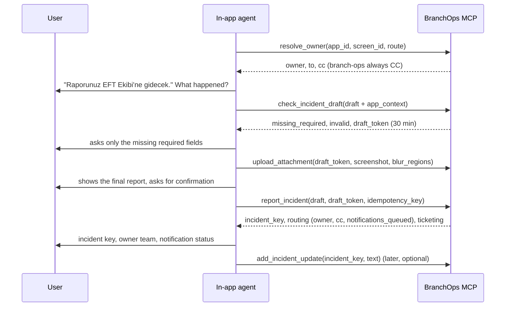

# Embedded agent guide

How an agent embedded in one of the bank's applications reports a problem to BranchOps through the MCP
server. The report carries full technical context and a screenshot, and is routed to the team that owns the
screen.

## Prerequisites

* **Connection.** Streamable HTTP to `https://branchops-mcp.apps.bank.internal/mcp` with
  `Authorization: Bearer <access token from the bank IdP>`, exactly as described in
  [MCP server](mcp-server.md#connecting-a-client). Behind oauth2-proxy, the signed-in user is the reporter.
* **Team allow-list.** The caller's MCP team must allow `check_incident_draft`, `report_incident`,
  `upload_attachment` and `add_incident_update`, and should allow `resolve_owner` and `list_teams`. These
  tools need no special role. A team with `tools: ["*"]` has them all.
* **Server.** `reporting.enabled: true` on the server; it adds the `app` source. Reports become incidents
  `app:RPT-…`.
* **Request size.** With reporting enabled, the MCP request limit grows to fit one base64-encoded
  attachment: `attachments.max_bytes × 4/3 + 64 KB`, i.e. about 4.1 MB for 3 MB files. Upload one file per call.

## 1. Gather `app_context` from the host application

Collect these yourself; never ask the user for them. Every field is optional, and unknown fields are
rejected.

| Field | Limit | What the server does |
|---|---|---|
| `app_id`, `screen_id` | 64 chars | Routing keys (see [ownership](ownership-and-routing.md)). The registry's application and screen names become known facts of the incident. |
| `screen_title` | 200 | Used as the screen name when the screen is not registered. |
| `route` | 500 | Query string and fragment removed, then masked; used for route-pattern matching. |
| `build_version`, `environment` | 60 / 40 | Masked. |
| `error_code` | 100 | Used by routing rules (`error_code_glob`). |
| `error_message` | 2000 | PII-masked, prompt-injection scan. |
| `correlation_id`, `trace_id` | 100 | Masked. |
| `last_requests` | max 20, each `method`, `path` (500), `status`, `duration_ms` | Query strings removed from paths. **Never send bodies or headers.** |
| `log_excerpt` | 4000 | PII-masked, prompt-injection scan. |
| `user_context` | `branch_code` (32), `username` (200), `role` (100) | `username` is **pseudonymised** with a keyed HMAC (`u-<16 hex>`); `branch_code` is used for routing rules. |
| `device` | `os`, `browser` (100), `resolution` (`1920x1080`) | Masked. |
| `occurred_at` | ISO 8601 | Stored. |

The masked context is stored separately (`incident_app_context`) and shown to analysts. It is used for
routing and is **never sent to the LLM**. Only the application and screen names from the registry reach the
analysis, as pre-filled facts.

## 2. Flow



| Step | Tool | Notes |
|---|---|---|
| Who receives it | `resolve_owner(app_id, screen_id?, route?)` | Read-only and deterministic. `matched_level` says how the owner was found; `unowned_screen: true` means branch operations will receive it as fallback. `list_teams` lists teams and contacts. |
| Check the draft | `check_incident_draft(draft)` | Draft fields: `title` (5–200), `description` (10–8000), plus optional `branch_code`, `application`, `category`, `error_details`, `occurred_at`, `reproduction_steps`, …, and `app_context`. Returns the template that will score the incident, `missing_required` / `missing_optional` with a `recommendation` text to ask from, `invalid`, `security_flags` and a short-lived `draft_token` (`attachments.draft_token_ttl_minutes`, default 30). Nothing about the report is stored. |
| Attach a screenshot | `upload_attachment(draft_token, filename, content_type, data_base64, kind, blur_regions?)` | PNG, JPEG or plain text; at most 3 MB after decoding and 5 files per incident. Content must match the declared type (magic bytes). Images are re-encoded, which drops EXIF, GPS and text chunks. `blur_regions` is a list of `[x, y, w, h]` (max 20), pixelated and blurred server-side. Text is PII-masked. Before the report, `incident_key` is `null` and `ticketing` is `pending_report`. You can also attach to an existing incident with `incident_key`. |
| Confirm | — | Show title, description and attachments, and wait for an explicit "evet". |
| Report | `report_incident(draft, draft_token?, idempotency_key?)` | Binds the draft's attachments, stores the masked `app_context`, routes and enqueues notifications in one transaction. Retrying with the same `idempotency_key` returns the same incident (`status: duplicate`). `extra.routing` has `owner_team`, `owner_team_name`, `cc_teams`, `matched_level`, `unowned_screen` and `notifications_queued`. `extra.attachments_bound` counts the files. `ticketing` is `queued` when a Jira ticket will be opened. |
| Add information | `add_incident_update(incident_key, text)` | Only for incidents reported through BranchOps that are visible to the caller, or the caller's own report while it is still queued. Triggers re-analysis and `update_added` notifications. |

The analysis runs asynchronously. Read the result later with `get_incident_analysis(incident_key)` (scores,
missing fields, recommendations).

## The `report-from-app` prompt

`prompts/get report-from-app {app_id, screen_id?}` returns step-by-step instructions that implement the flow
above:

1. Gather `app_context`.
2. Call `resolve_owner` and tell the user the owner.
3. Ask one open question.
4. Call `check_incident_draft` and ask only the missing required fields.
5. Take a screenshot, find customer data on it and pass it as `blur_regions`, then upload.
6. Confirm with the user, then `report_incident` with a fresh `idempotency_key`.
7. Show the incident key, the owner and the notification / ticket status.

Use it as the system prompt of the embedded agent. It contains no bank data.

## Errors

| Error (tool error text) | Meaning | What to do |
|---|---|---|
| `unknown draft token` / `draft token expired; call check_incident_draft again` / `draft token already used` | The token belongs to another user, is older than the TTL, or was already bound | Call `check_incident_draft` again for a new token, then re-upload. |
| `attachment exceeds … bytes`, `content type not allowed`, `content is not a valid image/png`, `at most 5 attachments per incident`, `image dimensions too large` | Upload limits | Downscale or crop the screenshot, or skip the attachment. |
| `incident not found or not visible to your team` | Scope check | Use the key returned by `report_incident`. |
| `invalid incident key` | Malformed key | Keys look like `app:RPT-K7Q2M9XA4B`. |
| HTTP 401 / 403 / 413 / 429 | Not authenticated, no MCP team, request too large, rate limit | Refresh the token, check the IdP group, or wait for `Retry-After`. |

Never retry `report_incident` with a **different** `idempotency_key` after a timeout: retry with the same
key.

## Sample transcript

> **User:** EFT gönderemiyorum, ekran dondu.

```json
→ resolve_owner {"app_id": "eft", "screen_id": "eft-new", "route": "/eft/new"}
← {"owner": {"key": "eft-team", "name": "EFT Ekibi", "email": "eft@bank.internal", ...},
   "cc": [{"key": "branch-ops", "name": "Şube Operasyon", ...}],
   "matched_level": "SCREEN_KEY", "unowned_screen": false, "screen_title": "Yeni EFT Gönderimi", ...}
```

> **Agent:** Üzgünüm. Bu ekranın sorumlusu **EFT Ekibi**; Şube Operasyon da bilgilendirilecek. Gönder'e
> bastığınızda ne oldu, hangi işlemi yapıyordunuz?
>
> **User:** Müşterinin EFT'sini gönderiyordum, 30 saniye bekledi sonra zaman aşımı dedi.

```json
→ check_incident_draft {"draft": {
    "title": "EFT ekranında gönder butonu zaman aşımı veriyor",
    "description": "Müşteri EFT işlemi gönderilirken ekran 30 saniye donuyor ve zaman aşımı hatası veriyor, işlem gerçekleşmiyor.",
    "error_details": "EFT-504 Gateway timeout",
    "app_context": {"app_id": "eft", "screen_id": "eft-new", "route": "/eft/new", "build_version": "4.12.0",
      "environment": "prod", "error_code": "EFT-504", "error_message": "Gateway timeout",
      "last_requests": [{"method": "POST", "path": "/api/eft/send", "status": 504, "duration_ms": 30012}],
      "user_context": {"branch_code": "1001", "username": "ayse.yilmaz", "role": "gişe"},
      "device": {"os": "Windows 11", "browser": "Edge 128", "resolution": "1920x1080"},
      "occurred_at": "2026-10-15T09:12:00+03:00"}}}
← {"ready": false, "template_id": "generic-operational-incident",
   "missing_required": [{"field": "occurrence_time", "label": "Oluşma zamanı",
     "recommendation": "Sorunun ne zaman yaşandığını belirtin ..."}],
   "draft_token": "dft_…", "draft_token_expires_at": "2026-10-15T09:44:00Z", ...}
```

> **Agent:** Bu ne zaman oldu, tam saatini hatırlıyor musunuz?
>
> **User:** Bugün 09:12 civarı.

```json
→ upload_attachment {"draft_token": "dft_…", "filename": "ekran.png", "content_type": "image/png",
    "kind": "screenshot", "data_base64": "iVBORw0K…", "blur_regions": [[412, 188, 320, 28]]}
← {"attachment_id": "6f1c…", "filename": "ekran.png", "size_bytes": 182334, "blurred_regions": 1,
   "incident_key": null, "ticketing": "pending_report"}
```

> **Agent:** Şunu göndereceğim: "EFT ekranında gönder butonu zaman aşımı veriyor" — bugün 09:12, hata
> EFT-504, ekran görüntüsü (müşteri adı bulanıklaştırıldı). Göndereyim mi?
>
> **User:** Evet.

```json
→ report_incident {"draft": {... "occurred_at": "2026-10-15T09:12:00+03:00"}, "draft_token": "dft_…",
    "idempotency_key": "eft-1001-7f3a9c"}
← {"incident_key": "app:RPT-K7Q2M9XA4B", "status": "accepted", "ticketing": "queued",
   "check": {"ready": true, ...},
   "extra": {"attachments_bound": 1,
     "routing": {"owner_team": "eft-team", "owner_team_name": "EFT Ekibi", "cc_teams": ["branch-ops"],
       "matched_level": "SCREEN_KEY", "unowned_screen": false, "notifications_queued": 3}}}
```

> **Agent:** Kaydınız oluşturuldu: **app:RPT-K7Q2M9XA4B**. EFT Ekibi'ne e-posta ile, Şube Operasyon'a
> e-posta ve Zoom ile bildirim gönderiliyor; ayrıca bir Jira kaydı açılacak. Yeni bir şey olursa bana
> söyleyin, kayda eklerim.
>
> **User:** Tekrar denedim, şimdi geçti.

```json
→ add_incident_update {"incident_key": "app:RPT-K7Q2M9XA4B", "text": "Kullanıcı tekrar denedi, işlem başarılı."}
← {"incident_key": "app:RPT-K7Q2M9XA4B", "comment_id": "a91f…", "status": "accepted"}
```
