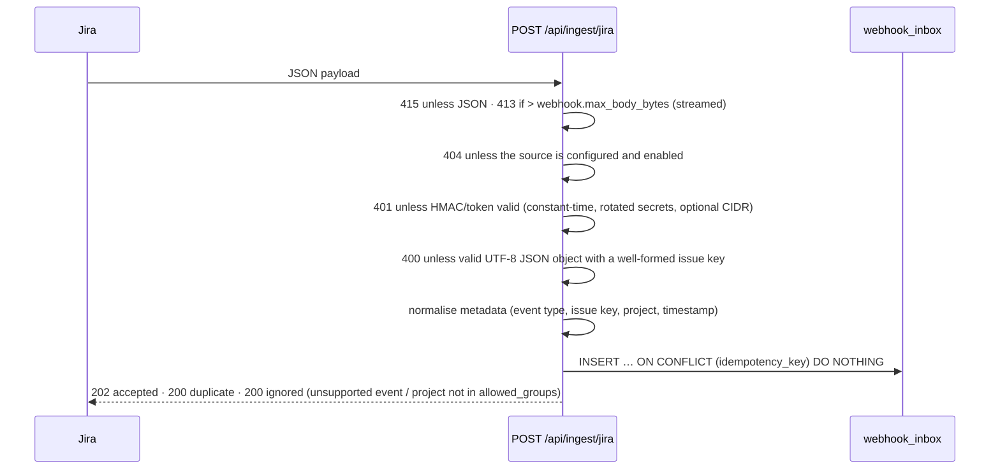

# Jira integration

Jira is one of several incident sources (see [sources](sources.md)): the `jira_webhook` adapter. Webhooks
are the only Jira ingestion mechanism: for ingestion BranchOps never calls the Jira REST API. The optional
ticketing sink ([MCP server](mcp-server.md), "Ticketing") creates tickets, comments and attachments for
MCP-reported incidents; those tickets carry the `branchops-reported` label. Exclude that label (or the
project) from the Jira source, otherwise a ticket is ingested back as a separate `jira:` incident. Jira records are identified as `jira:<issue key>` (e.g. `jira:BOPS-101`); API and dashboard URLs
still accept the bare issue key.

## Configuring the webhook in Jira

| Setting | Value |
|---|---|
| URL | `https://branchops-api.apps.bank.internal/api/ingest/jira` (primary; the legacy `…/api/webhooks/jira` remains valid). Both bypass SSO and are authenticated by the source's HMAC/token |
| Events | Issue: created, updated, deleted · Comment: created, updated, deleted |
| JQL filter (recommended) | `project in (BOPS, …)` — only branch-operations projects |
| Secret (Jira DC 10+ / Cloud) | a value from `JIRA_WEBHOOK_SECRETS` → Jira sends `X-Hub-Signature: sha256=<hmac>` |
| Older Jira without secrets | send header `X-BranchOps-Webhook-Token` via a reverse proxy, or (last resort) enable `auth.allow_query_token` on the source and register `…/jira?token=<value from JIRA_WEBHOOK_QUERY_TOKENS>` |

**Jira version compatibility.** Jira Data Center does not offer every authentication option that Jira
Cloud does. Choose the mode by version, not by assumption:

| Jira | Webhook secret | Custom request headers | BranchOps `auth.mode` |
|---|---|---|---|
| Cloud | yes (`X-Hub-Signature: sha256=…`) | no | `hmac` |
| Data Center ≥ 10.0 | yes (same header) | no | `hmac` |
| Data Center / Server 8.x–9.x | no | no | `token`, with an internal reverse proxy adding `X-BranchOps-Webhook-Token`; last resort: `allow_query_token` plus `allowed_source_cidrs` |

* The query token appears in the access logs of every proxy on the path. Prefer the reverse-proxy header,
  and rotate query tokens (`JIRA_WEBHOOK_QUERY_TOKENS` accepts several values).
* There is deliberately no IP-only mode: a source address is not authentication.
* HMAC is verified over the raw request bytes before parsing. Jira's scheme has no timestamp, so replay is
  handled by idempotency (below).

Configure the source under `sources:` (`id: jira`, `type: jira_webhook`); configurations that still use the
old `jira:` / `webhook:` sections are translated into exactly that source. Map the bank's custom fields
in `field_mapping`, for example
`branch_code: customfield_10101`, `application: customfield_10102`. Mapped fields take precedence over
values extracted by the model and carry `JIRA_FIELD` provenance.

## Request processing

No model call or issue processing happens in the request. The `idempotency_key` depends on how the request
was authenticated:

* **Signed request (HMAC):** `jira:sha256:<canonical payload>`. The digest is taken over the signed body only.
  The `X-Atlassian-Webhook-Identifier` header is not covered by the signature, so it must not decide
  idempotency: a captured delivery re-sent with a different identifier is still a duplicate. Jira's own
  retries carry the same body and are stored once.
* **Token request:** `jira:delivery:<X-Atlassian-Webhook-Identifier>` when present, otherwise the payload
  digest.

**Replay window.** An event whose own `timestamp` is older than `webhook.max_event_age_days` (7) is
acknowledged with `200 ignored` and not stored. For signed requests the timestamp is part of the signed body.
The setting must stay below `retention.inbox_days` (30), and startup is refused otherwise. This guarantees
that a delivery is only accepted while its idempotency key is still in the inbox. Without the window, a
captured delivery could be re-submitted once retention had purged its row.

Rejected requests (401, 400, 413, 415) are never written to the database. They are only counted in
`branchops_webhook_requests_total{outcome=…}` and logged without the body. A non-object `changelog`,
deeply nested JSON and `\u0000` produce 400 or are ignored, never a server error.

## Payload variants handled (`infrastructure/sources/jira/adapter.py`)

| Variation | Handling |
|---|---|
| `jira:issue_created/updated/deleted`, `comment_created/updated/deleted` | mapped to `JiraEventType` |
| Legacy comment notifications (`jira:issue_updated` + `issue_event_type_name = issue_commented / issue_comment_edited / issue_comment_deleted`) | mapped to comment events |
| Server/DC plain-text vs Cloud ADF descriptions and comments | ADF flattened to text (paragraphs, lists, mentions, hard breaks) |
| Custom field shapes: scalar, `{"value"}`, `{"name"}`, cascading `{"value","child"}`, arrays, ADF | flattened to text |
| Partial payloads (webhook field filtering) | only attributes present in the payload are emitted; values only present in the changelog (`toString`) are used as fallback |
| Jira timestamps `2026-10-14T09:12:33.000+0300`, epoch milliseconds | parsed to timezone-aware datetimes |
| Unknown events (`sprint_*`, `project_*`, …) | acknowledged and ignored |

## Asynchronous processing and ordering

* Workers claim events with `FOR UPDATE SKIP LOCKED` and take a **lease** (`worker.lease_seconds`,
  renewed by a heartbeat) identified by a unique per-claim token. Only the oldest pending event of an
  issue is eligible, and never while another event of that issue is in progress. A run whose lease was
  lost (e.g. reaped after a stall) cannot complete or fail the event afterwards.
* A per-issue PostgreSQL advisory lock serialises processing across workers; a busy issue's event is
  released without consuming an attempt.
* **Out-of-order delivery** is handled by the merge, not by delivery order: each snapshot attribute stores
  the source timestamp (`fields.updated`, or the webhook `timestamp`) at which it was written, and older
  events cannot overwrite newer values. Comments are versioned by their own `updated` timestamp;
  deletions are tombstones (a late "comment updated" cannot resurrect a deleted comment, a late "issue
  updated" cannot resurrect a deleted issue).
* **Partial payloads never erase data**: an absent or empty value is ignored unless the changelog
  explicitly lists that field as changed (a real user clear).
* Missing information stays missing: it is never inferred from other events.
* Analysis runs only when analysis-relevant content changed (summary, description, labels, components,
  type, priority, mapped fields, comments). The input hash (content + template versions + scoring policy +
  prompt version + model) prevents duplicate analyses for no-op updates or redeliveries.
* Failures: transient errors are retried with exponential backoff + jitter
  (`worker.backoff_base_seconds` … `backoff_max_seconds`) up to `worker.max_attempts`; then the event is
  `DEAD_LETTER`.
  * Replay from the dashboard, `POST /api/admin/inbox/{id}/replay` or `branchops replay`. Replay resets
    the attempts and clears the outcome; `last_error` is kept for the investigation trail.
  * Invalid payloads (poison messages) are dead-lettered immediately, without retries.
  * Stored error text is PII-masked, and database parameter dumps are cut.
  * Model outages are handled separately and recovered later; see
    [model recovery](model-integration.md#model-outages-and-recovery).
* Crash recovery: expired leases (crashed or killed worker) are returned to `PENDING` by the next worker
  poll. If that was the last attempt, the event becomes `DEAD_LETTER` (with `processed_at` set and the
  payload redacted).
* Graceful shutdown: on SIGTERM a worker stops claiming and waits up to `worker.shutdown_grace_seconds` (60)
  for in-flight events. It then hands unfinished events back to `PENDING` without consuming an attempt, so
  another replica continues at once instead of after `lease_seconds`. Keep `terminationGracePeriodSeconds`
  (120 in `worker.yaml`) above the grace period.
* Correlation: each request gets an `X-Correlation-ID` (accepted from the caller if well-formed) that is
  stored on the inbox row, propagated to logs, traces, LLM request headers and the analysis record.

## Retention policies

| Event | Policy | Effect |
|---|---|---|
| Issue deleted | `retention.on_issue_deleted: soft_delete` (default) | issue hidden from dashboard, API and similarity; relationships removed; analyses kept for audit |
| | `purge` | content, comments, analyses, steps and relationships deleted; a content-free tombstone row (key + deleted flag) is kept so late events cannot re-create the issue; audit log entry kept |
| Comment deleted | `retention.redact_deleted_comments: true` (default) | comment body erased, tombstone kept; issue re-analysed without it |
| Raw payloads | `retention.redact_inbox_payload_after_processing: true` (default) | inbox payload replaced with a PII-masked copy once processed, and also when dead-lettered (by the runner or the lease reaper); the JSON structure is kept, so a dead letter can still be replayed |
| Finished inbox events | `retention.inbox_days: 30` | `COMPLETED`/`SKIPPED` events and their LangGraph checkpoint threads deleted hourly by the worker (`branchops inbox purge` runs it now); a delivery re-sent after that is accepted again and is a no-op for the merge |
| Dead letters | `retention.inbox_dead_letter_days: 90` | kept longer for inspection and replay, then deleted the same way |

Pending and in-progress events hold the raw payload until processed. This is the window in which the inbox
holds unmasked data; the worker masks the payload before anything else is derived from it.

All free text is masked (TCKN, IBAN, card numbers, phone numbers, e-mail, configurable extra patterns)
before it is stored in issue tables or sent to the model.

## Manual re-analysis

Analysts can request re-analysis (dashboard button or `POST /api/issues/{key}/reanalyze`). It enqueues
a `MANUAL_REANALYSIS` inbox event (audited) that bypasses the input-hash check — useful after a template
or model change.
