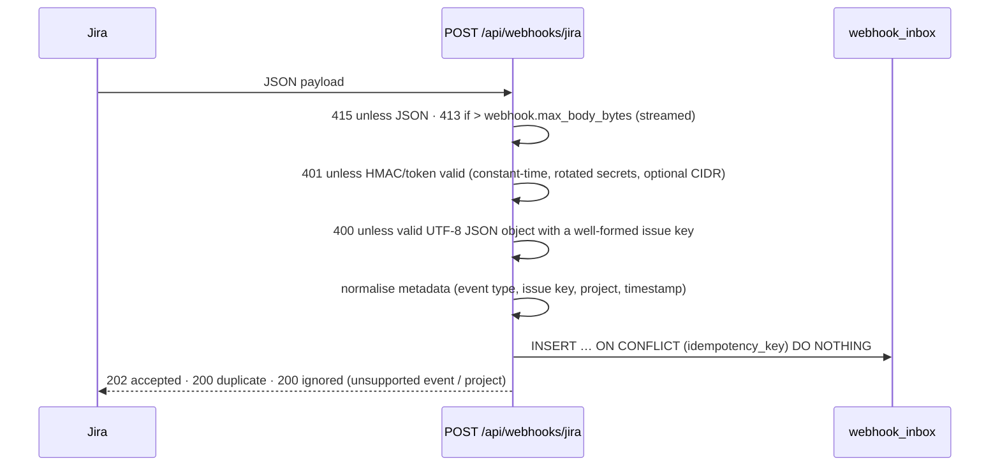

# Jira integration

Webhooks are the **only** ingestion mechanism. BranchOps never calls the Jira REST API and never modifies
Jira issues.

## Configuring the webhook in Jira

| Setting | Value |
|---|---|
| URL | `https://branchops-api.apps.bank.internal/api/webhooks/jira` |
| Events | Issue: created, updated, deleted · Comment: created, updated, deleted |
| JQL filter (recommended) | `project in (BOPS, …)` — only branch-operations projects |
| Secret (Jira DC 10+ / Cloud) | a value from `JIRA_WEBHOOK_SECRETS` → Jira sends `X-Hub-Signature: sha256=<hmac>` |
| Older Jira without secrets | send header `X-BranchOps-Webhook-Token` via a reverse proxy, or (last resort) enable `webhook.allow_query_token` and register `…/jira?token=<value from JIRA_WEBHOOK_QUERY_TOKENS>` |

Map the bank's custom fields in configuration (`jira.field_mapping`), for example
`branch_code: customfield_10101`, `application: customfield_10102`. Mapped fields take precedence over
values extracted by the model and carry `JIRA_FIELD` provenance.

## Request processing

No model call or issue processing happens in the request. `idempotency_key` is
`delivery:<X-Atlassian-Webhook-Identifier>` when Jira sends it, otherwise `sha256:<canonical payload>`,
so Jira retries of the same delivery are stored once.

## Payload variants handled (`infrastructure/jira/adapter.py`)

| Variation | Handling |
|---|---|
| `jira:issue_created/updated/deleted`, `comment_created/updated/deleted` | mapped to `JiraEventType` |
| Legacy comment notifications (`jira:issue_updated` + `issue_event_type_name = issue_commented / issue_comment_edited / issue_comment_deleted`) | mapped to comment events |
| Server/DC plain-text vs Cloud ADF descriptions and comments | ADF flattened to text (paragraphs, lists, mentions, hard breaks) |
| Custom field shapes: scalar, `{"value"}`, `{"name"}`, cascading `{"value","child"}`, arrays, ADF | flattened to text |
| Partial payloads (webhook field filtering) | only attributes present in the payload are emitted; values only present in the changelog (`toString`) are used as fallback |
| Jira timestamps `2026-10-14T09:12:33.000+0300`, epoch milliseconds | parsed to timezone-aware datetimes |
| Unknown events (`sprint_*`, `project_*`, …) | acknowledged and ignored |

## Asynchronous processing and ordering

* Workers claim events with `FOR UPDATE SKIP LOCKED` and take a **lease** (`worker.lease_seconds`,
  renewed by a heartbeat) identified by a unique per-claim token. Only the oldest pending event of an
  issue is eligible, and never while another event of that issue is in progress. A run whose lease was
  lost (e.g. reaped after a stall) cannot complete or fail the event afterwards.
* A per-issue PostgreSQL advisory lock serialises processing across workers; a busy issue's event is
  released without consuming an attempt.
* **Out-of-order delivery** is handled by the merge, not by delivery order: each snapshot attribute stores
  the source timestamp (`fields.updated`, or the webhook `timestamp`) at which it was written, and older
  events cannot overwrite newer values. Comments are versioned by their own `updated` timestamp;
  deletions are tombstones (a late "comment updated" cannot resurrect a deleted comment, a late "issue
  updated" cannot resurrect a deleted issue).
* **Partial payloads never erase data**: an absent or empty value is ignored unless the changelog
  explicitly lists that field as changed (a real user clear).
* Missing information stays missing: it is never inferred from other events.
* Analysis runs only when analysis-relevant content changed (summary, description, labels, components,
  type, priority, mapped fields, comments). The input hash (content + template versions + scoring policy +
  prompt version + model) prevents duplicate analyses for no-op updates or redeliveries.
* Failures: transient errors are retried with exponential backoff + jitter
  (`worker.backoff_base_seconds` … `backoff_max_seconds`) up to `worker.max_attempts`; then the event is
  `DEAD_LETTER` (replay from the dashboard, `POST /api/admin/inbox/{id}/replay` or `branchops replay`).
  Invalid payloads are dead-lettered immediately. Expired leases (crashed worker) are returned to
  `PENDING` by the next worker poll.
* Correlation: each request gets an `X-Correlation-ID` (accepted from the caller if well-formed) that is
  stored on the inbox row, propagated to logs, traces, LLM request headers and the analysis record.

## Retention policies

| Event | Policy | Effect |
|---|---|---|
| Issue deleted | `retention.on_issue_deleted: soft_delete` (default) | issue hidden from dashboard, API and similarity; relationships removed; analyses kept for audit |
| | `purge` | content, comments, analyses, steps and relationships deleted; a content-free tombstone row (key + deleted flag) is kept so late events cannot re-create the issue; audit log entry kept |
| Comment deleted | `retention.redact_deleted_comments: true` (default) | comment body erased, tombstone kept; issue re-analysed without it |
| Raw payloads | `retention.redact_inbox_payload_after_processing: true` (default) | inbox payload replaced with a PII-masked copy once processed |

All free text is masked (TCKN, IBAN, card numbers, phone numbers, e-mail, configurable extra patterns)
before it is stored in issue tables or sent to the model.

## Manual re-analysis

Analysts can request re-analysis (dashboard button or `POST /api/issues/{key}/reanalyze`). It enqueues
a `MANUAL_REANALYSIS` inbox event (audited) that bypasses the input-hash check — useful after a template
or model change.
