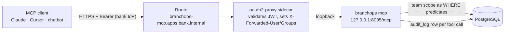

# MCP server

`branchops mcp` is a [Model Context Protocol](https://modelcontextprotocol.io) server. It is read-only except
for re-analysis requests and, when `reporting.enabled`, incident reporting. Other teams
connect their own MCP clients (Claude Desktop / Claude Code, Cursor, internal chatbots) and query analysed
incident data: search, incident details, analyses, similar and recurring incidents, quality figures and
templates.

The server **serves verified, authorisation-filtered data, not reasoning**:

* It never calls the LLM. All reasoning happens in the client, with the client's model.
* Every tool is a fixed, parameterised query from `application/queries`, the same read models the API and
  dashboard use. There is no raw-SQL or free-form query tool, and the server never runs SQL written by a
  model or a client.
* What a caller can see (rows), which tools exist for them, and whether free text is masked all come from
  the caller's **team**, which is resolved from their IdP groups. Row visibility is enforced in SQL.



## Connecting a client

Clients use **streamable HTTP** at `https://branchops-mcp.apps.bank.internal/mcp`. Every request needs an
access token from the bank IdP, sent as `Authorization: Bearer <token>`. Get the token through your team's
usual flow (client credentials for service accounts and chatbots, device or authorization-code flow for
people). The token's audience must include `branchops-mcp`, and the user or service account must be in one
of the configured team groups.

**Claude Code**

```bash
claude mcp add --transport http branchops https://branchops-mcp.apps.bank.internal/mcp \
  --header "Authorization: Bearer ${BRANCHOPS_MCP_TOKEN}"
```

**Claude Desktop** (`claude_desktop_config.json`). Remote servers with a custom header go through the
`mcp-remote` bridge, installed from the internal npm mirror:

```json
{
  "mcpServers": {
    "branchops": {
      "command": "npx",
      "args": [
        "mcp-remote",
        "https://branchops-mcp.apps.bank.internal/mcp",
        "--header",
        "Authorization:${BRANCHOPS_MCP_AUTH}"
      ],
      "env": {
        "BRANCHOPS_MCP_AUTH": "Bearer <access token from the bank IdP>",
        "NPM_CONFIG_REGISTRY": "https://artifactory.bank.internal/api/npm/npm-remote/"
      }
    }
  }
}
```

**Cursor** (`.cursor/mcp.json`):

```json
{
  "mcpServers": {
    "branchops": {
      "url": "https://branchops-mcp.apps.bank.internal/mcp",
      "headers": {"Authorization": "Bearer ${env:BRANCHOPS_MCP_TOKEN}"}
    }
  }
}
```

**Local development.** `make up` starts the `mcp` compose service at `http://localhost:8095/mcp` with dev
authentication (no token, every caller is the dev user). `make run-mcp` runs the server from the virtualenv
with the same URL. `make mcp-health` checks readiness and lists the tools. For a stdio client,
`branchops --config config/local.yaml mcp --stdio`. Stdio works only with `auth_mode: dev` and is refused in
production.

## Team scopes

```yaml
mcp:
  host: 127.0.0.1
  port: 8095
  max_page_size: 50                  # caps page_size in search_incidents
  max_text_chars: 4000               # longer description/comment text is cut and marked
  rate_limit_per_minute: 120         # per principal, per replica (429 + Retry-After)
  max_request_bytes: 65536           # larger JSON-RPC requests get 413 (raised for attachments, see below)
  teams:
    - id: branch-ops
      groups: [branchops-branch-ops] # IdP groups from the oauth2-proxy groups header
      sources: ["*"]
      group_keys: ["*"]
      branch_codes: ["*"]
      fields: full                   # full | masked
      tools: ["*"]
      role: ANALYST                  # MCP-only role (default VIEWER); request_reanalysis needs ANALYST
    - id: app-support
      groups: [branchops-app-support]
      sources: [jira, snow]
      group_keys: [OPS, APP]
      branch_codes: ["*"]
      fields: masked
      tools: [search_incidents, get_incident, get_incident_analysis, find_similar_incidents,
              list_recurring_errors, get_template, list_templates]
    - id: audit
      groups: [branchops-audit]
      fields: full                   # sources/group_keys/branch_codes default to ["*"]
      tools: ["*"]
      ops_access: true               # get_inbox_health without the ADMIN role
```

* **Roles.** A team's `role` applies only in the MCP server; it is added to the caller's global roles from
  `security.role_groups`. Do **not** add team groups to `security.role_groups`, because that would let
  MCP-only users into the unscoped REST API and dashboard.
* **Resolution.** Each request: `resolve_principal` checks the identity headers and only trusts them from the
  loopback proxy, otherwise **401**. The principal's groups then select the teams, and no matching team means
  **403**. A user in several teams gets the union of their scopes.
* **Rows.** A team grants an incident when its `source`, `group_key` and `branch_code` are each in the team's
  lists (`"*"` = any; an incident without a branch code only matches `branch_codes: ["*"]`). These are SQL
  `WHERE` predicates added to the query (`application/queries/scope.py`), so counts, pages and aggregates
  only ever include visible rows. Out-of-scope incidents behave like non-existent ones ("not found").
* **Tools.** A tool is listed and callable only if a team allows it. A hidden tool is absent from
  `tools/list`, and calling it fails like an unknown tool. A tool call gets the scope and field mode of the
  teams that allow *that tool*, so membership in a broad read-only team never widens what another team's
  `request_reanalysis` can reach.
  * `request_reanalysis` also needs the **ANALYST** role.
  * `get_inbox_health` also needs **ADMIN** or a team with `ops_access: true`.
* **Fields.** For `fields: masked`, free text (title, description, comments, evidence quotes, rationales,
  recommendations) goes through the PII masker again (TCKN, IBAN, card, phone, e-mail and the configured
  extra patterns), and comment authors are hidden. Callers that have any masked team also search with masked
  input with every token containing a digit or `@` dropped (incident keys such as `OPS-123` are kept), so
  a known TCKN, card number or e-mail cannot be used to probe masked text, even when split into pieces.
  Text is stored masked at ingestion anyway; re-masking also covers patterns added later.
* **Production guard.** With `app.environment: production`, `branchops mcp` refuses to start when no team is
  configured or `auth_mode` is `dev`. It also refuses unknown tool names in `tools`.

Keep the oauth2-proxy `OAUTH2_PROXY_ALLOWED_GROUPS` of the MCP sidecar (`deploy/openshift/base/mcp.yaml`) and
the consumer namespaces in the `branchops-mcp-allow-consumers` NetworkPolicy (production overlay) in sync
with `mcp.teams`.

## Tool catalogue

All tools are read-only except `request_reanalysis` and the reporting tools below. Outputs are typed (JSON schema published in
`tools/list`) and bounded by page size, result limits and `max_text_chars`. Any value that was cut ends with
`…[truncated: N of M chars]`, and its path is listed in the response's `truncated` field. Scores are 0–100 and
computed deterministically by BranchOps; clients should report them, not recompute them.

| Tool | Parameters | Returns |
|---|---|---|
| `search_incidents` | `query?`, `category?`, `branch_code?`, `application?`, `source?`, `status?` (analysis status), `low_quality_only=false`, `since_days=30`, `sort=updated\|quality\|completeness\|incident_key`, `page=1` (≤ 200), `page_size=25` (≤ `max_page_size`) | page of incident summaries + `total`, `has_more` |
| `get_incident` | `incident_key` | title, description, the 20 most recent comments, source status, latest scores |
| `get_incident_analysis` | `incident_key` | classification, per-field assessments (state, rubric level, credits), missing / insufficient fields, recommendations, verified evidence quotes, template id/version, scoring policy version |
| `find_similar_incidents` | `incident_key` **or** `text`, `limit=10` | `DUPLICATE_CANDIDATE` / `RELATED` / `UNVERIFIED_CANDIDATE` relationships with signals and rationale, `RECURRING` (same error signature) or `TEXT_MATCH` (full-text search) |
| `list_recurring_errors` | `since_days=30`, `min_count=3`, `branch_code?`, `application?` | groups by error signature: count, first/last seen, branches, applications, sources, incident keys |
| `get_quality_overview` | `since_days=30` | totals, average completeness/quality, low-quality and needs-review counts, category/source distribution, daily trend |
| `get_quality_analytics` | `since_days=90` | scores by category and branch, most missing fields, quality changes after re-analysis |
| `list_templates` | – | latest published templates with required fields |
| `get_template` | `template_id`, `version?` | fields with weights, required/conditional rules, validation, rubric, recommendation |
| `get_inbox_health` | – | pending / processing / dead-letter counts, oldest pending age (s), active workers |
| `request_reanalysis` | `incident_key`, `reason` (5–500 chars) | `{status: queued, event_id}`; enqueues a `MANUAL_REANALYSIS` inbox event |

### Reporting tools (`reporting.enabled: true`)

| Tool | Parameters | Returns |
|---|---|---|
| `check_incident_draft` | `draft` (title, description, branch_code?, application?, error_details?, occurred_at?, …, `app_context?`) | the template the incident would be scored with, missing required/optional fields with what to ask, invalid values, prompt-injection flags, and a short-lived `draft_token` for uploads. Deterministic; the report itself is not stored. |
| `upload_attachment` | `filename`, `content_type` (`image/png`, `image/jpeg`, `text/plain`), `data_base64`, `kind` (`screenshot` / `log` / `other`), `incident_key` **or** `draft_token`, `blur_regions?` (`[[x, y, w, h], …]`, max 20) | `attachment_id`, size after re-encoding, `blurred_regions`, `incident_key` (null while on a draft), `ticketing` (`queued` / `disabled` / `pending_report`) |
| `report_incident` | `draft`, `idempotency_key?`, `draft_token?` | `incident_key` (`app:RPT-…`), `status` (`accepted` / `duplicate`), `ticketing` (`queued` / `disabled`), the draft check; `extra.routing` (owner team, CC teams, matched level, queued notifications) and `extra.attachments_bound` |
| `add_incident_update` | `incident_key`, `text` (3–4000 chars) | `comment_id`; the incident is re-analysed and `update_added` notifications go to the routed teams |
| `list_teams` | – | active teams with public contacts and working hours |
| `resolve_owner` | `app_id`, `screen_id?`, `route?` | owner, To and CC teams, matched level, `unowned_screen`, application/screen names, reasons (deterministic; see [ownership and routing](ownership-and-routing.md)) |

* **Reports.** A report is an ordinary incident of the `mcp_report` source (`reporting.source_id`, default
  `app`). The command writes the canonical event to the inbox in one transaction, together with a ticket
  request when a ticketing sink is configured. The worker masks, merges and analyses it like any other
  source; the reporter is the authenticated user.
* **Idempotency.** Repeating `report_incident` with the same `idempotency_key` (per user) returns the same
  incident key.
* **Updates.** Only incidents reported through BranchOps can be updated, and only by callers whose scope
  includes them (or by the reporter while the report is still queued).
* `list_teams` and `resolve_owner` are read tools and are registered even when reporting is disabled.
* **In-app context and attachments.** `draft.app_context` (application, screen, route, error code, recent
  requests, log excerpt, device …) is masked, stored separately, used for routing and never sent to a model.
  Attachments are re-encoded (metadata dropped), blurred where requested, size- and count-limited and never
  sent to a model. See the [embedded agent guide](embedded-agent-guide.md).
* **Routing.** `report_incident` resolves the owning team from the ownership registry and enqueues
  notifications (owner To, branch operations CC); see [ownership and routing](ownership-and-routing.md).
* **Request size.** With reporting enabled the request limit is raised to fit one base64 attachment:
  `max(mcp.max_request_bytes, attachments.max_bytes × 4/3 + 64 KB)` (≈ 4.1 MB for 3 MB files).
* **Ticketing** (`ticketing.sink: jira`). The worker drains `ticketing_outbox` and, through the internal Jira
  REST API, creates a ticket in the owner team's `jira_project_key` (else `default_project_key`), adds
  updates as comments and forwards attachments. Only masked text leaves
  BranchOps. Tickets carry the `branchops-reported` label: exclude that label or the project from the Jira
  source so that the tickets are not ingested back.

Examples (arguments as a client sends them):

```json
{"name": "search_incidents", "arguments": {"branch_code": "1001", "since_days": 7, "sort": "quality"}}
{"name": "get_incident_analysis", "arguments": {"incident_key": "jira:OPS-123"}}
{"name": "find_similar_incidents", "arguments": {"text": "EFT işlemi zaman aşımı hata kodu EFT-504", "limit": 5}}
{"name": "list_recurring_errors", "arguments": {"since_days": 90, "min_count": 5}}
{"name": "request_reanalysis", "arguments": {"incident_key": "snow:INC0012345", "reason": "Template 1.1.0 published"}}
```

### Resources and prompts

| Resource | Content |
|---|---|
| `branchops://templates/{template_id}/{version}` | a published template as JSON |
| `branchops://scoring/policy` | the current scoring policy (credits, thresholds, version) |
| `branchops://glossary` | categories and subcategories, canonical field names and labels, field states, rubric levels and credits, score definitions, analysis statuses, relationship types, enabled sources. Generated from the enums, scoring modules and templates, never hand-written. |

| Prompt | Arguments | Guides the client to |
|---|---|---|
| `weekly-branch-report` | `branch_code`, `days=7` | page through the branch's incidents, recurring errors and weakest analyses, then write a report |
| `investigate-recurring-error` | `error_signature` | collect the signature's group, incident analyses and related incidents; separate observations from hypotheses |
| `missing-information-checklist` | `incident_key` | combine the analysis with its template into a checklist and a message to the branch |
| `report-from-app` | `app_id`, `screen_id?` | for agents embedded in a bank application: gather `app_context`, tell the user the owner (`resolve_owner`), ask only missing required fields, upload a blurred screenshot, confirm, report, show key / owner / notification status |

Prompts contain no bank data; they only say which tools to call and how to present the results.

## Audit trail and observability

Every tool call writes one `audit_log` row:

* `actor` is the IdP user, `action` is `mcp_tool_call`, and `resource_id` is the tool name.
* `details` holds `team`, `arguments`, `rows`, `duration_ms`, `outcome` and, on failure, `error`.
  * `arguments` are recorded with secret-like keys dropped, text PII-masked and cut to 200 characters.
  * `outcome` is `ok`, `rejected` (e.g. not found, invalid key), `denied` (hidden tool) or `error`.

`request_reanalysis` additionally writes `reanalysis_requested` (`details.via = "mcp"`, masked `reason`).

```sql
SELECT created_at, actor, resource_id AS tool, details->>'team' AS team, details->>'outcome' AS outcome,
       details->'arguments' AS arguments, details->>'rows' AS rows
FROM audit_log WHERE action = 'mcp_tool_call' ORDER BY created_at DESC LIMIT 50;
```

Each call also produces one INFO log line (`mcp tool <name> <outcome>` with actor, team, rows, duration),
and Prometheus metrics on `/metrics`:

| Metric | Labels |
|---|---|
| `mcp_tool_calls_total` | `tool`, `team`, `outcome` |
| `mcp_tool_latency_milliseconds` (histogram) | `tool`, `team`, `outcome` |
| `mcp_auth_failures_total` | `reason` (`unauthenticated`, `no_team`, `rate_limited`) |

`/healthz` (liveness), `/readyz` (database reachable) and `/metrics` are served without authentication, the
same as the worker's probe endpoints.

## Deployment

`deploy/openshift/base/mcp.yaml` deploys the server with the same layout as the dashboard:

* **Deployment.** The app binds to 127.0.0.1:8095 with an oauth2-proxy sidecar on 8443.
  * The sidecar accepts IdP JWT bearer tokens (`--skip-jwt-bearer-tokens`).
  * It answers `/mcp` with 401 instead of a login redirect (`--api-route`).
  * It skips authentication only for `GET /healthz|readyz|metrics`.
  * Pods run non-root with a read-only root filesystem and all capabilities dropped. The fastmcp update
    check is disabled.
* **Service and Route** (`branchops-mcp.apps.bank.internal`, reencrypt).
* **HorizontalPodAutoscaler** (2–4 replicas) and a PodDisruptionBudget. The transport is stateless, so no
  session affinity is needed.
* **NetworkPolicy** `branchops-mcp-allow-consumers`: ingress only from the consuming teams' namespaces
  (replace the placeholder selector in the overlay) and from the router for desktop clients.

The shared policies add egress to PostgreSQL and SSO and monitoring ingress for the MCP pods.

## Security notes

* The server never executes model-written or client-written SQL, and it has no free-form query tool. Tool
  arguments are typed, length-bounded and bound as SQL parameters.
* It never calls the LLM and has no egress except PostgreSQL (plus SSO and OTel for the sidecar and traces).
* Data returned to a client may reach that team's model provider and chat history. Give each team the
  narrowest scope, prefer `fields: masked`, and keep `max_text_chars` small.
* The rate limit is in memory and applies per replica; the oauth2-proxy and Route timeouts bound long
  requests.
