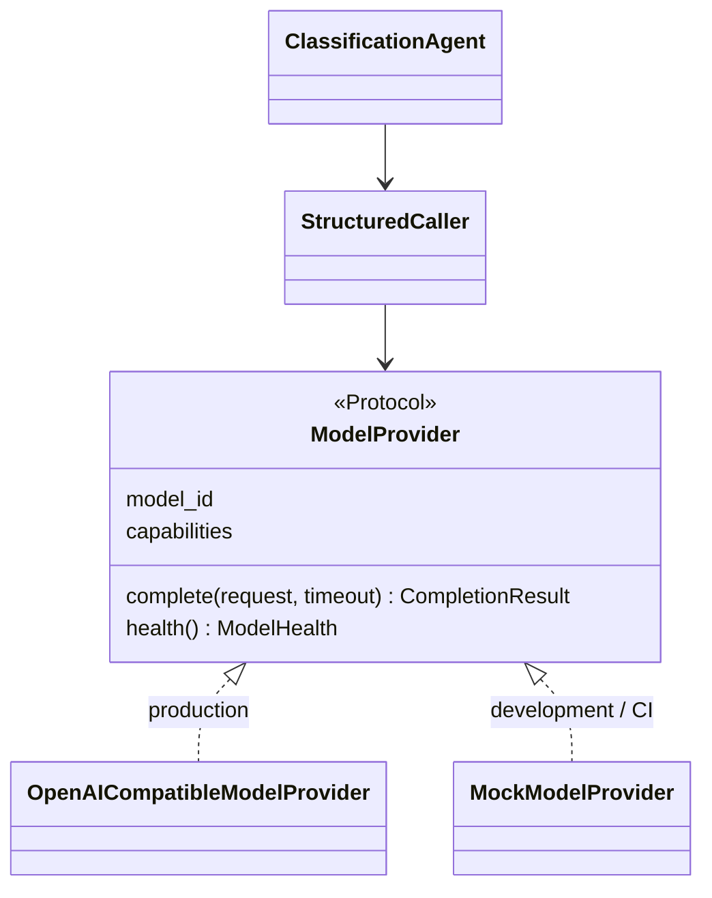

# Model integration

BranchOps uses the bank's existing inference services. It never deploys, downloads or fine-tunes a model
and never calls a public API.

## Provider abstraction



Agents depend only on `ModelProvider` (`application/interfaces/model_provider.py`). A provider for
another internal serving stack (e.g. a non-OpenAI REST API) is a new class implementing the protocol plus
a branch in `container.create_model_provider`.

## Configuration

```yaml
llm:
  provider: openai-compatible        # or "mock" (refused in production)
  base_url: ${LLM_BASE_URL}          # internal gateway, e.g. https://llm-gateway.ai-platform.svc.cluster.local/v1
  model: ${LLM_MODEL:-GLM-5.3-Flash} # never hard-coded in code
  api_key_env: LLM_API_KEY           # name of the env var holding the key (optional for mTLS/no-auth gateways)
  timeout_seconds: 120
  max_retries: 2                     # client-level retries on connection errors / 429 / 5xx
  temperature: 0
  max_output_tokens: 2048
  ca_bundle: /etc/pki/bank/ca-bundle.crt
  capability_detection: explicit     # explicit | probe
  capabilities:
    tool_calling: false              # never used by BranchOps
    structured_outputs: false        # response_format json_schema
    json_mode: true                  # response_format json_object
    reasoning_parameters: false      # send reasoning_effort only if true AND llm.reasoning_effort set
    context_length: 32768
    max_output_tokens: 4096
  reasoning_effort: null
  extra_body: {}                     # gateway-specific parameters, passed verbatim
```

| Parameter | Notes |
|---|---|
| `base_url` | Must pass the outbound URL guard: host ends with an `network.allowed_host_suffixes` entry or is a private IP. Production requires `https://`. |
| `ca_bundle` | Internal CA file. TLS verification is always on (`CERT_REQUIRED`, hostname check); there is no option to disable it. |
| `capabilities` | Declared, not assumed. Use `branchops llm probe` to test `json_schema` and `json_object` support against the real gateway and copy the result into config, or set `capability_detection: probe` to probe at worker start. |
| `context_length` | Inputs are truncated proportionally by `workflow.max_input_chars` (default 24 000 characters ≈ well below 32k tokens for Turkish). |
| `extra_body` | e.g. vLLM `{"guided_decoding_backend": "xgrammar"}` or gateway routing hints. |

## Output modes and fallback

| Mode | Request | Used when |
|---|---|---|
| `json_schema` | `response_format={"type":"json_schema", …, "strict": false}` | `capabilities.structured_outputs` |
| `json_object` | `response_format={"type":"json_object"}` | `capabilities.json_mode` |
| `prompt_only` | no `response_format`; schema in the system prompt | neither, or after the gateway rejected the other modes |

If the gateway answers 400/422 to a `response_format`, the caller downgrades to the next mode and keeps
using it for the rest of the process. Whatever the mode, output is parsed and validated with Pydantic and
repaired at most `workflow.max_repair_attempts` times. Temperature 0 is requested but **not relied on**
for determinism; scores never depend on free-form model output.

## Reliability

| Concern | Behaviour |
|---|---|
| Timeouts | per request `min(llm.timeout_seconds, remaining node budget)` |
| Transient errors (connect, timeout, 429, 5xx) | `ModelUnavailableError` → client retries → node retry → inbox retry with backoff → provisional (recoverable) analysis on the last attempt → automatic recovery (below) |
| Access errors (401/403, 404 unknown model or path) | `ModelAccessError`, a request error that operations fix (rotated key, renamed model), so it is retried and recovered like an outage; never includes key material |
| Rejected requests (400 incl. context length, invalid output) | `ModelRequestError` / `StructuredOutputError`, no retry, step `FAILED`, analysis `PARTIAL`/`NEEDS_REVIEW` (not recoverable: waiting does not fix them) |
| Health | `branchops llm health` calls `/models` (10 s, no retries) and checks the configured model is served |
| Token usage / latency | recorded per step and as metrics `branchops_model_tokens`, `branchops_model_latency_milliseconds` |
| Correlation | `X-Correlation-ID` and `X-Agent` headers on every model request |
| Reasoning content | `<think>` blocks and `reasoning_content` are discarded, never logged or stored |

## Model outages and recovery

A model outage must not lose data or leave incidents with a permanently degraded analysis.

1. **Retries first.** The client, LangGraph node and inbox retries (`worker.max_attempts`, exponential
   backoff) absorb short outages.
2. **Provisional result.** On the last inbox attempt the workflow runs with `allow_degraded`.
   * Steps whose model call failed for a transient reason are recorded as `DEGRADED`, and the analysis is
     stored with `recoverable = true`. Its status is `NEEDS_REVIEW` if classification degraded, otherwise
     `PARTIAL`.
   * The inbox event completes, so nothing is lost and history is kept.
3. **The current analysis is protected.** A provisional result never replaces a non-provisional current
   analysis of the issue, and no result of an older issue version (`source_updated_at`) or older run replaces
   a newer one (`AnalysisRepository.replaces_latest`). A provisional result also never suppresses a later
   redelivery: its input hash is ignored by the "no analysis-relevant change" check.
4. **Recovery state machine** (`analysis_recovery`, one row per incident). It is updated in the same
   transaction as the stored analysis:

   ```
   RECOVERY_PENDING ──enqueue──▶ RUNNING ──complete analysis──▶ COMPLETED
          ▲                        ├─degraded again / event dead-lettered──▶ RETRY_WAIT ──due──▶ RUNNING
          │                        └─attempts ≥ recovery.max_attempts──────▶ FAILED_PERMANENT
          └─ a new provisional analysis after a terminal state starts a new cycle
   ```

   These map onto the requested states. Pending, running and completed exist as such. RETRY_WAIT is the
   wait between attempts. PARTIAL→RECOVERY_PENDING is the recoverable flag. FAILED_PERMANENT is reached only
   by exhausting the attempts; non-transient failures never enter the machine.
5. **Scheduler.** The scheduler (`workers/recovery.py`) runs every `recovery.interval_seconds` in each worker
   replica. It:
   * closes stale `RUNNING` analysis rows (no heartbeat for `stale_running_minutes`) as `FAILED`;
   * moves on recovery rows whose event was dead-lettered or lost;
   * probes the model once when recoveries are due, and does nothing while the model is down, without
     consuming attempts;
   * claims at most `recovery.batch_size` due rows (`SKIP LOCKED`) and enqueues one re-analysis inbox event
     per incident. Enqueueing is idempotent per degraded analysis and attempt, and is skipped while an event
     for the incident is queued or running, so there are never duplicate active executions.

   Backoff is `base_delay_seconds × 2^attempt`, capped at `max_delay_seconds`, with 75–100 % jitter.
6. **Manual recovery.** `branchops recover [--incident KEY]` runs one tick and can make one incident due
   now. The analyst's "Yeniden analiz" button and MCP `request_reanalysis` keep working as before.

| Metric | Meaning |
|---|---|
| `branchops_model_up{model}` | 1/0 from the worker's 60-second health probe (readiness deliberately ignores the model) |
| `branchops_recovery_analyses{state}` | recovery rows per state (pending backlog, permanent failures) |
| `branchops_recovery_oldest_pending_seconds` | age of the oldest unrecovered provisional analysis |
| `branchops_recovery_events_total{event}` | `recoverable_failure`, `enqueued`, `recovered`, `retry`, `exhausted`, `skipped_model_down`, `superseded` |
| `branchops_model_health_checks_total{healthy}` | health probe results |

Recovery success rate = `recovered / (recovered + exhausted)`. Example alerts are in
`deploy/openshift/examples/prometheusrule.yaml`.

## Embeddings

The generative model is **not** used for embeddings. Similarity uses PostgreSQL full-text search. To add
semantic retrieval with an approved internal embedding model, implement `HistoricalIssueReader` with a
pgvector query (embeddings computed by that internal model in the worker) — the agent and workflow stay
unchanged.

## Verifying against the real gateway

```bash
export BRANCHOPS_CONFIG=config/branchops.yaml LLM_BASE_URL=https://… LLM_API_KEY=…
branchops llm health
branchops llm probe
BRANCHOPS_LLM_INTEGRATION=1 pytest -m llm_integration tests/integration/test_llm_endpoint.py
```
