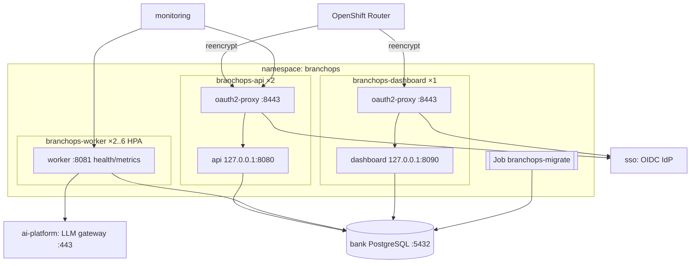

# OpenShift deployment (offline)

## Topology



One image, four commands (`api`, `worker`, `dashboard`, `migrate`). The LLM is **not** deployed here;
the worker calls the existing gateway configured through `LLM_BASE_URL`.

## 1. Build the wheelhouse (connected build zone)

On a build host that can reach the **internal** PyPI mirror (Artifactory/Nexus), never the internet:

```bash
PIP_INDEX_URL=https://artifactory.bank.internal/api/pypi/pypi-remote/simple ./scripts/build_wheelhouse.sh
```

`requirements.lock` pins every runtime dependency (`requirements-dev.lock` adds test tools). Regenerate
the lock with `uv pip compile pyproject.toml -o requirements.lock` when dependencies change and run
the dependency scan required by the bank before publishing.

## 2. Build and push the image (no network access needed)

```bash
podman build -f deploy/docker/Dockerfile \
  --build-arg BASE_IMAGE=registry.bank.internal/ubi9/python-312:latest \
  -t registry.bank.internal/branchops/branchops-intelligence:0.1.0 .
podman push registry.bank.internal/branchops/branchops-intelligence:0.1.0
```

`make image` does the same (`PROD_BASE`, `PROD_IMAGE` variables). `WHEELHOUSE_SOURCE=offline` is the
Dockerfile default; the `online` source used by docker compose is never built in this mode (BuildKit
skips unused stages). The Dockerfile installs with `pip --no-index --find-links=/wheelhouse`, so a missing wheel fails the
build instead of reaching an index. The image runs as UID 1001 / group 0 with group-writable
directories (arbitrary-UID compatible), contains templates and migrations, and writes only to `/tmp`
(mounted `emptyDir`). Mirror `oauth2-proxy` into the internal registry as well.

## 3. Prepare the namespace

```bash
oc new-project branchops
# Secrets from the bank's secret store (see deploy/openshift/base/secret.example.yaml for the keys):
oc create secret generic branchops-secrets \
  --from-literal=DATABASE_URL='postgresql+psycopg://branchops:…@postgres.db-shared.svc:5432/branchops' \
  --from-literal=LLM_BASE_URL='https://llm-gateway.ai-platform.svc.cluster.local/v1' \
  --from-literal=LLM_API_KEY='…' \
  --from-literal=JIRA_WEBHOOK_SECRETS='current,previous' \
  --from-literal=DASHBOARD_STORAGE_SECRET="$(openssl rand -base64 32)"
oc create secret generic oauth2-proxy-secrets \
  --from-literal=OAUTH2_PROXY_CLIENT_ID=branchops \
  --from-literal=OAUTH2_PROXY_CLIENT_SECRET='…' \
  --from-literal=OAUTH2_PROXY_COOKIE_SECRET="$(openssl rand -base64 32 | head -c 32)"
```

Database: create a `branchops` database and user on the bank's PostgreSQL (≥ 14; `turkish` text search
configuration is built in). The migration job needs DDL rights; runtime pods need DML only.

## 4. Configure and deploy

Edit `deploy/openshift/base/branchops.yaml` (copied from `config/branchops.example.yaml`) and the overlay
for your environment: route hosts, Jira custom field ids, `network.allowed_host_suffixes`, namespace
labels in `networkpolicies.yaml` (`db-shared`, `ai-platform`, `sso`, `observability`), OIDC issuer in
`kustomization.yaml`, image tags.

```bash
oc apply -k deploy/openshift/overlays/production     # includes the migrate Job (Argo CD PreSync hook)
oc wait --for=condition=complete job/branchops-migrate --timeout=300s
oc rollout status deploy/branchops-api deploy/branchops-worker deploy/branchops-dashboard
oc exec deploy/branchops-worker -- branchops llm health
```

Without Argo CD, delete and re-create the Job for every release before rolling out the Deployments.

## Resources, probes, scaling

| Workload | Requests / limits | Probes | Scaling |
|---|---|---|---|
| api | 100m/256Mi → 1 CPU/512Mi (+ proxy 20m/32Mi) | startup `/health/startup`, readiness `/health/ready` (DB ping), liveness `/health/live` — via proxy skip-auth routes | 2 replicas, PDB minAvailable 1 |
| worker | 100m/384Mi → 1 CPU/768Mi | `/healthz` (poll loop alive), `/readyz` (DB reachable) on :8081 | HPA 2–6 on CPU; throughput is bounded by `worker.concurrency × replicas` and the gateway's capacity |
| dashboard | 100m/256Mi → 1 CPU/512Mi | `/health/live`, `/health/ready` | 1 replica (NiceGUI state is per process; use Route session affinity if scaled) |

Worker scaling note: LLM-bound work is I/O-heavy, so CPU-based HPA reacts slowly. Watch
`branchops_inbox_depth{status="PENDING"}` and `branchops_inbox_oldest_pending_seconds`; raise
`minReplicas` or `worker.concurrency` if the backlog grows (respect the gateway's rate limits).

## Observability

* Metrics: Prometheus format on the API (`/metrics` through the proxy) and worker (`:8081/metrics`).
  Create a `ServiceMonitor` for `branchops-api` (port https, path /metrics, scheme https) and
  `branchops-worker-metrics`.
* Key series: `branchops_webhook_requests_total{outcome}`, `branchops_webhook_latency_milliseconds`,
  `branchops_inbox_depth{status}`, `branchops_inbox_oldest_pending_seconds`,
  `branchops_worker_events_total{outcome}`, `branchops_worker_failures_total{kind,final}`,
  `branchops_agent_duration_milliseconds{step,status}`, `branchops_model_latency_milliseconds{agent,model}`,
  `branchops_model_tokens_total{agent,model,type}`, `branchops_structured_output_failures_total{agent,mode}`,
  `branchops_classification_failures_total`, `branchops_completeness_score`, `branchops_quality_score`.
* Traces: set `observability.otlp_endpoint` to the **internal** OTel collector (guarded); spans for
  webhook, worker event, workflow and every model call carry `branchops.correlation_id`.
* Logs: JSON on stdout with `correlation_id`, collected by the cluster logging stack.

Suggested alerts: dead letters > 0; oldest pending > 15 min; `branchops_model_errors_total` rate > 0 for
10 min; structured output failure ratio > 10 %; webhook 401 spikes.

## Air-gap checklist

- [ ] Image and oauth2-proxy pulled only from `registry.bank.internal`
- [ ] Wheelhouse built from the internal mirror; `pip --no-index` in the Dockerfile
- [ ] `network.allowed_host_suffixes` lists only internal domains; startup fails on public URLs
- [ ] Default-deny NetworkPolicies applied; egress limited to DNS, PostgreSQL, LLM gateway, SSO, collector
- [ ] No CDN/web fonts (NiceGUI bundles all assets; `tests/unit/test_airgap.py`)
- [ ] No update checks / telemetry: NiceGUI `on_air=None`, `show=False`; OTel exporters only if configured
- [ ] No Hugging Face / model downloads: the application contains no model loading code

## Upgrades and rollback

* Migrations are forward-only in production (Alembic `downgrade` exists for development). Take a DB
  snapshot before releases with schema changes.
* Templates: published versions are immutable; rollback = publish the previous content as a new version.
* Rolling back the image is safe for in-flight events: leases expire and events are retried; checkpoints
  are keyed by inbox event and discarded if the input hash differs.
