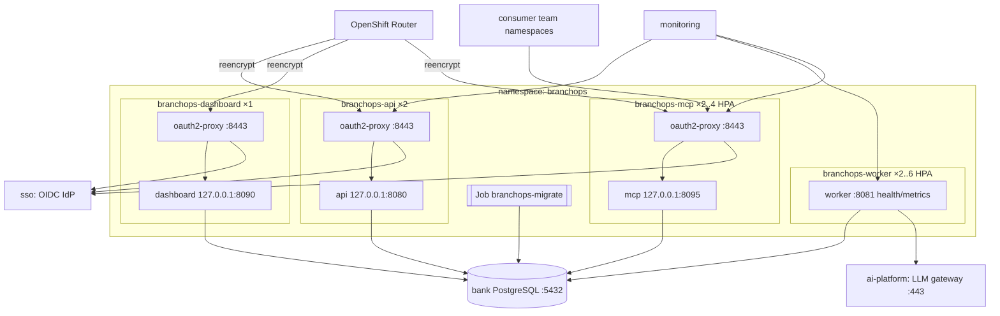

# OpenShift deployment (offline)

## Topology



One image, five commands (`api`, `worker`, `dashboard`, `mcp`, `migrate`); see [MCP server](mcp-server.md)
for the MCP consumers' NetworkPolicy and team configuration. The LLM is **not** deployed here;
the worker calls the existing gateway configured through `LLM_BASE_URL`.

## 1. Build the wheelhouse (connected build zone)

On a build host that can reach the **internal** PyPI mirror (Artifactory/Nexus), never the internet:

```bash
PIP_INDEX_URL=https://artifactory.bank.internal/api/pypi/pypi-remote/simple ./scripts/build_wheelhouse.sh
```

`requirements.lock` pins every runtime dependency (`requirements-dev.lock` adds test tools). Regenerate
the lock with `uv pip compile pyproject.toml -o requirements.lock` when dependencies change and run
the dependency scan required by the bank before publishing.

## 2. Build and push the image (no network access needed)

Pin the base image by digest for reproducible builds (`podman pull …:latest && podman inspect --format
'{{.Digest}}'`), and use `BASE_IMAGE=registry.bank.internal/ubi9/python-312@sha256:…`. The `:latest` tag
below is only an example.

```bash
podman build -f deploy/docker/Dockerfile \
  --build-arg BASE_IMAGE=registry.bank.internal/ubi9/python-312:latest \
  -t registry.bank.internal/branchops/branchops-intelligence:0.1.0 .
podman push registry.bank.internal/branchops/branchops-intelligence:0.1.0
```

`make image` does the same (`PROD_BASE`, `PROD_IMAGE` variables). `WHEELHOUSE_SOURCE=offline` is the
Dockerfile default; the `online` source used by docker compose is never built in this mode (BuildKit
skips unused stages). The Dockerfile installs with `pip --no-index --find-links=/wheelhouse`, so a missing wheel fails the
build instead of reaching an index. The image runs as UID 1001 / group 0 with group-writable
directories (arbitrary-UID compatible), contains templates and migrations, and writes only to `/tmp`
(mounted `emptyDir`). Mirror `oauth2-proxy` into the internal registry as well.

## 3. Prepare the namespace

```bash
oc new-project branchops
# Secrets from the bank's secret store (see deploy/openshift/base/secret.example.yaml for the keys):
oc create secret generic branchops-secrets \
  --from-literal=DATABASE_URL='postgresql+psycopg://branchops:…@postgres.db-shared.svc:5432/branchops' \
  --from-literal=LLM_BASE_URL='https://llm-gateway.ai-platform.svc.cluster.local/v1' \
  --from-literal=LLM_API_KEY='…' \
  --from-literal=JIRA_WEBHOOK_SECRETS='current,previous' \
  --from-literal=DASHBOARD_STORAGE_SECRET="$(openssl rand -base64 32)"
oc create secret generic oauth2-proxy-secrets \
  --from-literal=OAUTH2_PROXY_CLIENT_ID=branchops \
  --from-literal=OAUTH2_PROXY_CLIENT_SECRET='…' \
  --from-literal=OAUTH2_PROXY_COOKIE_SECRET="$(openssl rand -base64 32 | head -c 32)"
```

Database: create a `branchops` database and user on the bank's PostgreSQL (≥ 14; `turkish` text search
configuration is built in). The migration job needs DDL rights; runtime pods need DML only.

## 4. Configure and deploy

Edit `deploy/openshift/base/branchops.yaml` (copied from `config/branchops.example.yaml`) and the overlay
for your environment: route hosts, Jira custom field ids, `network.allowed_host_suffixes`, namespace
labels in `networkpolicies.yaml` (`db-shared`, `ai-platform`, `sso`, `observability`), OIDC issuer in
`kustomization.yaml`, image tags.

```bash
oc apply -k deploy/openshift/overlays/production     # includes the migrate Job (Argo CD PreSync hook)
oc wait --for=condition=complete job/branchops-migrate --timeout=300s
oc rollout status deploy/branchops-api deploy/branchops-worker deploy/branchops-dashboard deploy/branchops-mcp
oc exec deploy/branchops-worker -- branchops llm health
```

### Database migration procedure

Migrations must finish before new pods start. With Argo CD the Job is a PreSync hook, so the ordering is
automatic. Without Argo CD, `oc apply -k` creates the Job and the Deployments together, so run the Job
first:

```bash
oc delete job branchops-migrate --ignore-not-found
oc kustomize deploy/openshift/overlays/production | \
  python3 -c 'import sys, yaml; print(yaml.safe_dump_all([d for d in yaml.safe_load_all(sys.stdin) if d and d["kind"] in ("Job", "ConfigMap", "ServiceAccount")]))' | \
  oc apply -f -
oc wait --for=condition=complete job/branchops-migrate --timeout=600s
oc apply -k deploy/openshift/overlays/production
```

`branchops migrate` is idempotent. It runs the Alembic upgrade to head, sets up the LangGraph checkpoint
tables, and checks template immutability before publishing new template versions. A failed Job leaves the
Deployments untouched.

## Internal certificates

* The trusted CA bundle is the ConfigMap `bank-ca-bundle`. It is injected by OpenShift
  (`config.openshift.io/inject-trusted-cabundle: "true"`) and mounted read-only at
  `/etc/pki/bank/ca-bundle.crt` in every pod.
* Each outbound client uses it explicitly, with verification always on:

  | Client | Setting |
  |---|---|
  | LLM gateway | `llm.ca_bundle` |
  | Embeddings | `workflow.similarity.embeddings.ca_bundle` |
  | PostgreSQL | `database.sslmode: verify-full`, `sslrootcert` |
  | SMTP, Zoom, Jira ticketing, object store | their `ca_bundle` settings |
  | oauth2-proxy | `OAUTH2_PROXY_PROVIDER_CA_FILES` |

* No code path disables TLS verification. `tests/unit/test_openai_provider.py` asserts `CERT_REQUIRED`.
* Tools that read `SSL_CERT_FILE` only (for example `curl` in a debug session) need
  `SSL_CERT_FILE=/etc/pki/bank/ca-bundle.crt`.

## Model availability and graceful shutdown

* **The model is managed separately.** No pod requests a GPU (`tests/unit/test_deploy_manifests.py`); the
  worker calls the existing gateway.
* **Readiness never depends on the model.** The api, worker, dashboard and mcp readiness probes check the
  database only, so a model outage does not stop webhook ingestion or remove pods from service.
  * The worker probes the model every 60 s and exports `branchops_model_up`.
  * Analyses made during an outage are stored as provisional and recovered automatically
    ([model integration](model-integration.md#model-outages-and-recovery)).
* **Worker shutdown.** On SIGTERM the worker stops claiming and finishes in-flight events for up to
  `worker.shutdown_grace_seconds` (60). It then hands unfinished events back without consuming an attempt,
  so they are not stuck until the lease expires. `terminationGracePeriodSeconds: 120` covers this.
* **api, dashboard, mcp shutdown.** A `preStop` `sleep 5` lets the router and Service endpoints drop the
  pod before the app stops, and `terminationGracePeriodSeconds: 45` covers in-flight requests. The
  oauth2-proxy image is distroless and has no `sleep`; it shuts down on SIGTERM after the app container's
  preStop.

## Resources, probes, scaling

| Workload | Requests / limits | Probes | Scaling |
|---|---|---|---|
| api | 100m/256Mi → 1 CPU/512Mi (+ proxy 20m/32Mi) | startup `/health/startup`, readiness `/health/ready` (DB ping), liveness `/health/live` — via proxy skip-auth routes | 2 replicas, PDB minAvailable 1 |
| worker | 100m/384Mi → 1 CPU/768Mi | `/healthz` (poll loop alive), `/readyz` (DB reachable) on :8081 | HPA 2–6 on CPU; throughput is bounded by `worker.concurrency × replicas` and the gateway's capacity |
| dashboard | 100m/256Mi → 1 CPU/512Mi | `/health/live`, `/health/ready` | 1 replica (NiceGUI state is per process; use Route session affinity if scaled) |
| mcp | 100m/192Mi → 1 CPU/512Mi (+ proxy 20m/32Mi) | `/healthz`, `/readyz` (DB ping) via proxy skip-auth routes | HPA 2–4 on CPU; stateless streamable HTTP, no session affinity; rate limit is per replica |

Worker scaling note: LLM-bound work is I/O-heavy, so CPU-based HPA reacts slowly.

* Watch `branchops_inbox_depth{status="PENDING"}` and `branchops_inbox_oldest_pending_seconds`.
* If the backlog grows, raise `minReplicas` or `worker.concurrency` (YAML `worker.concurrency`, 1–32).
  Respect the gateway's concurrency, because effective parallelism is `replicas × concurrency`.
* Scaling on queue depth needs a custom-metrics adapter (Prometheus Adapter or KEDA). Neither is part of
  these manifests. When the platform provides one, replace the CPU target with
  `branchops_inbox_depth{status="PENDING"}` per replica.

**Sizing assumptions.**

| Assumption | Value |
|---|---|
| Incidents | up to a few thousand new or updated per day |
| Model calls per analysis | 5 (6 with investigation) |
| Latency per model call | 5–30 s from the internal gateway |

* A worker spends most of its time waiting, so memory (prompt and state buffers) drives sizing more than
  CPU.
* 2 replicas × concurrency 2 handles roughly 200–600 analyses per hour, depending on the gateway.
* The API is lightweight: inserts only, no model work.
* Re-measure with `branchops_agent_duration_milliseconds` before changing limits.

## Observability

* Metrics: Prometheus format on the API (`/metrics` through the proxy) and worker (`:8081/metrics`).
  Create a `ServiceMonitor` for `branchops-api` (port https, path /metrics, scheme https) and
  `branchops-worker-metrics`.
* Key series: `branchops_webhook_requests_total{outcome}`, `branchops_webhook_latency_milliseconds`,
  `branchops_inbox_depth{status}`, `branchops_inbox_oldest_pending_seconds`,
  `branchops_worker_events_total{outcome}`, `branchops_worker_failures_total{kind,final}`,
  `branchops_agent_duration_milliseconds{step,status}`, `branchops_model_latency_milliseconds{agent,model}`,
  `branchops_model_tokens_total{agent,model,type}`, `branchops_structured_output_failures_total{agent,mode}`,
  `branchops_classification_failures_total`, `branchops_completeness_score`, `branchops_quality_score`.
* Traces: set `observability.otlp_endpoint` to the **internal** OTel collector (guarded); spans for
  webhook, worker event, workflow and every model call carry `branchops.correlation_id`.
* Logs: JSON on stdout with `correlation_id`, collected by the cluster logging stack.

Example alerts are in `deploy/openshift/examples/prometheusrule.yaml`. It is not applied by default, so
review the thresholds first. It covers:

* dead letters;
* inbox backlog;
* webhook auth failures;
* model down (`branchops_model_up`);
* recovery backlog and exhausted recoveries;
* structured-output failure ratio.

Recovery series: `branchops_recovery_analyses{state}`, `branchops_recovery_oldest_pending_seconds`,
`branchops_recovery_events_total{event}`.

## What has been verified

* `kubectl kustomize` renders the base and production overlay.
* `tests/unit/test_deploy_manifests.py` checks the security contexts, resources, probes, grace periods and
  skip-auth routes.
* The containers run as an arbitrary UID with a read-only root filesystem under docker compose (`make up`).
* **Not verified:** a deployment to an OpenShift cluster (none was available), a run against the bank's
  registry, CA and gateway, and OpenShift SCC admission. Verify these in a staging namespace with
  `oc apply -k`, `oc rollout status` and the air-gap checklist below.

## Air-gap checklist

- [ ] Image and oauth2-proxy pulled only from `registry.bank.internal`
- [ ] Wheelhouse built from the internal mirror; `pip --no-index` in the Dockerfile
- [ ] `network.allowed_host_suffixes` lists only internal domains; startup fails on public URLs
- [ ] Default-deny NetworkPolicies applied; egress limited to DNS, PostgreSQL, LLM gateway, SSO, collector
- [ ] No CDN/web fonts (NiceGUI bundles all assets; `tests/unit/test_airgap.py`)
- [ ] No update checks / telemetry: NiceGUI `on_air=None`, `show=False`; OTel exporters only if configured
- [ ] No Hugging Face / model downloads: the application contains no model loading code

## Upgrades and rollback

* Migrations are forward-only in production (Alembic `downgrade` exists for development). Take a DB
  snapshot before releases with schema changes.
* **Expand/contract rule.** A release may only *add* nullable columns, columns with server defaults, tables
  and indexes. Removing or renaming happens in a later release, after no running image uses the old shape.
  Then rolling back the image is safe without rolling back the schema.
  * Migrations 0008–0010 (recovery, embeddings, investigation) follow the rule: the previous image runs
    unchanged against the new schema.
  * Do **not** roll back the scoring policy config to an unregistered version. Startup refuses changed
    parameters under a released version.
* Templates: published versions are immutable; rollback = publish the previous content as a new version.
* Rolling back the image is safe for in-flight events: leases expire and events are retried; checkpoints
  are keyed by inbox event and discarded if the input hash differs.
