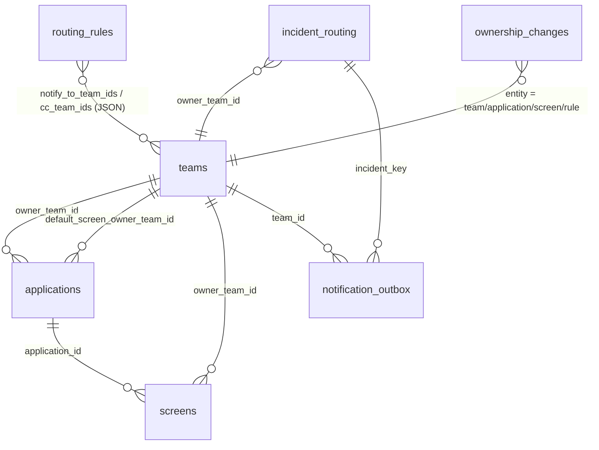

# Ownership and routing

Reports from the bank's applications are sent automatically to the team that owns the affected screen, with
the branch operations team always in copy. Who owns what is **data**, not code: teams, applications, screens
and routing rules are managed in the dashboard (`/yonetim`, ADMIN) or through the REST API. Every change is
recorded in a change log.

Routing is **deterministic**. No model is involved: the owner is a pure function of the registry snapshot and
the incident's application context and classification (`domain/entities/ownership.py:resolve_owner`).

## Data model



| Table | Purpose | Key columns |
|---|---|---|
| `teams` | Who receives reports | `key` (unique), `name`, `kind` (`branch_ops` / `app_owner` / `platform` / `security` / `other`), `email`, `zoom_channel_id`, `zoom_webhook_secret_ref` (**name** of the env var holding the token), `jira_project_key`, `oncall_contact`, `working_hours`, `active`, created/updated at/by |
| `applications` | Applications of the bank | `key` (unique), `name`, `owner_team_id`, `default_screen_owner_team_id` (nullable), `active` |
| `screens` | Screens of an application | `application_id`, `key` (unique per application), `title`, `route_pattern` (nullable), `owner_team_id`, `tags`, `active` |
| `routing_rules` | Extra recipients by condition | `name`, `priority` (lower runs first), `match` (JSON), `notify_to_team_ids`, `cc_team_ids`, `channels` (`email`, `zoom`), `active` |
| `ownership_changes` | Append-only history of **every** registry write | `occurred_at`, `actor`, `entity`, `entity_id`, `action` (`create`, `update`, `delete`, `activate`, `deactivate`, `owner_change`, `reorder`), `before`, `after` (JSON) |
| `incident_routing` | Current decision per reported incident | `owner_team_id`, `to_team_ids`, `cc_team_ids`, `channels`, `matched_level`, `unowned_screen`, `screen_unregistered`, `application_key`, `screen_key`, `matched_rule_ids`, `reasons`, `decided_by` (`report` / `analysis` / `reroute:<user>`), `reported_at`, `decided_at`, `first_notified_at` |
| `notification_outbox` | One message to one recipient on one channel | outbox columns + `event`, `channel`, `recipient` (address or Zoom channel id), `team_id`, `role` (`to` / `cc`) |

Keys (`team.key`, `application.key`, `screen.key`) match `^[a-z0-9][a-z0-9._-]{0,63}$`. In-app agents report the
application and screen by these keys (`app_context.app_id` / `screen_id`).

Migrations: `0005_ownership_registry` (registry and change log), `0007_notifications_routing`
(`incident_routing`, `notification_outbox`).

## Resolution order

`resolve_owner(app_context, classification, registry, branch_ops_team_key=...)` returns a `RoutingDecision`.
The application is looked up by key from `app_context.app_id`, or else by the classification's free-text
application. Matching is case-insensitive and also works on the application name. Inactive applications,
screens and teams are skipped, and so is an owner team that is inactive.

| # | Level (`matched_level`) | Owner |
|---|---|---|
| 1 | `SCREEN_KEY` | the screen with that exact key in the application |
| 1 | `SCREEN_ROUTE` | the screen whose `route_pattern` matches the route; the most specific pattern wins (most literal characters, fewest wildcards) |
| 2 | `APPLICATION_DEFAULT_SCREEN_OWNER` | `application.default_screen_owner_team_id` |
| 3 | `APPLICATION_OWNER` | `application.owner_team_id` |
| 4 | `ROUTING_RULE` | the first `notify_to` team of the first matching rule (by priority, then id) |
| 5 | `BRANCH_OPS_FALLBACK` | the team `ownership.branch_ops_team_key` (default `branch-ops`) |

What the other recipients are, whichever level found the owner:

* **To:** the owner, plus the `notify_to_team_ids` of **every** matching active rule.
* **CC:** the `cc_team_ids` of every matching rule, plus the branch operations team. A team never appears
  twice, and branch operations is not in CC when it is the owner.
* **Channels:** the union of the matching rules' `channels`, or `email` + `zoom` when no rule matched.
* **`reasons`:** explains each step (e.g. `screen eft/eft-new -> eft-team`, `matched rules: ...`).

Two flags mark gaps in the registry:

* `unowned_screen`: resolution **fell back to branch operations** although the client named an
  application, screen or route. It triggers `ownership_unresolved`.
* `screen_unregistered`: the client named a screen (key or route) that matched no registered screen,
  **whoever** ended up owning it (e.g. the application owner).

Both feed the dashboard's "Sahipsiz ekranlar" list. Unknown application and screen keys are kept in the
decision so that an owner can be assigned later.

### Route patterns

A pattern is a `/`-separated list of segments:

| Segment | Meaning | Example |
|---|---|---|
| literal text | must be equal (case-insensitive) | `/eft/new` |
| a whole `{param}` segment | any single segment | `/customers/{id}/accounts` |
| `*` as the **last** segment only | the rest of the path (also matches the prefix itself) | `/eft/*` matches `/eft`, `/eft/a/b` |

Query strings and fragments are stripped from the route before matching, and full internal URLs are reduced
to their path. Partial wildcards (`a*b`), several parameters in one segment (`{a}{b}`) and `*` in the middle
are rejected when the screen is saved. This keeps matching linear: no pattern can cause catastrophic regex
backtracking. Invalid patterns stored earlier simply never match.

### Routing rules

`match` must contain at least one condition. All present conditions must hold:

| Field | Compared with |
|---|---|
| `category` | the classification category (exact, case-insensitive) |
| `application_key` | the resolved application's key or name, or the classification's free-text application |
| `screen_key` | the matched screen key, else the reported screen key |
| `error_code_glob` | `app_context.error_code`, glob with `*` / `?` (`CARD-*`) |
| `branch_code_glob` | the branch code (`user_context.branch_code` or the draft), glob (`1*`) |

A rule needs at least one recipient team. Allowed channels are `email` and `zoom`. Rules are evaluated in
`priority` order (lower first); reordering in the dashboard renumbers them 10, 20, 30, ….

## When routing happens

| Moment | What happens |
|---|---|
| `report_incident` (MCP) | Resolve from `app_context` and the draft. Branch code, category and application are taken from the draft. The decision is persisted in `incident_routing` with `decided_by = report`, in the same transaction as the report. The ticket project is the owner's `jira_project_key` when set (else `ticketing.default_project_key`). `incident_reported` is enqueued, plus `ownership_unresolved` when `unowned_screen`. The tool result's `extra.routing` contains the owner, CC teams, matched level and number of queued notifications. |
| After each analysis (worker) | Resolve again with the analysis's category, application and branch code. Teams added by rules are **merged in**: nobody is ever removed and branch operations stays in CC. `analysis_ready` goes to all routed teams, once per analysis. Only incidents with a routing record (in-app reports) are notified. |
| `add_incident_update` (MCP) | `update_added` to the routed teams. |
| "Yeniden yönlendir" (ANALYST, dashboard or `POST /api/routing/{key}/reroute`) | Resolve with the **current** registry and the stored app context. The decision is **replaced** (`decided_by = reroute:<user>`) and `incident_reported` (marked "yeniden yönlendirildi") goes to the new recipients. Audited as `incident_rerouted`. |

The application and screen **names** from the registry are also given to the analysis as known facts
(`mapped_fields.application` / `screen`). They count as provided in `check_incident_draft` and raise
completeness.

## Notifications

| Event | Recipients | Content |
|---|---|---|
| `incident_reported` | To: owner + rule teams; CC: rule CC teams + branch operations | summary, masked description excerpt, error code, application, screen, branch, owner, CC teams, matched level, attachment count, dashboard link |
| `analysis_ready` | all routed teams (union after merging rule teams) | category, completeness and quality (0–100), missing fields, similar incidents (duplicate / related), teams added by the analysis |
| `ownership_unresolved` | branch operations + `ownership.platform_team_key` (default `platform`), always e-mail + Zoom | unknown application / screen keys and route, with a request to assign an owner |
| `update_added` | routed teams | masked update text and author |
| `test` | one team, every configured channel | "Test bildirimi" from the dashboard or `POST /api/admin/ownership/teams/{id}/test-notification` |

A team receives a message on a channel only if it has that channel configured (`email` or
`zoom_channel_id`). Rendering happens **at enqueue time** with masked data only, so an outbox row is an exact
record of what was sent.

### Channels

| Channel | Backend | Notes |
|---|---|---|
| E-mail | `notifications.email.backend: smtp` | Internal relay `smtp_host:smtp_port` with STARTTLS against `ca_bundle` and optional AUTH (`username_env` / `password_env`). The host must pass the outbound host guard. From is `from_name <from_address>`. HTML + plain text. **Delivery is to the row's recipient only**; the `To`/`Cc` headers show the decision's addresses for context. Headers `X-BranchOps-Incident` and `X-BranchOps-Event` are set. |
| Zoom Team Chat | `notifications.zoom.backend: webhook` | `POST <webhook_base_url>/<team.zoom_channel_id>?format=full` with header `Authorization: <token>`. The token is read from the env var named in `team.zoom_webhook_secret_ref`; when it is missing, the row is dead-lettered. `webhook_base_url` is the bank's **egress proxy** and must pass the outbound URL guard. The message card carries key facts only: incident key, summary (≤160 chars), screen, owner, missing fields, attachment count, on-call when out of hours, link. It never contains the description or a screenshot. |
| Development | `backend: log` (default) / `null` | `log` writes the envelope (event, recipient, subject), never the body; `null` drops. |

### Working hours

`teams.working_hours` is, for example, `Mon-Fri 08:30-17:30` or `Pzt-Cmt 09:00-18:00 UTC`:

* Several ranges can be separated by `;`.
* Day names are English or Turkish three-letter abbreviations.
* The zone defaults to Europe/Istanbul.
* An empty value means "always reachable".

Outside a recipient team's hours the message is **still sent**, with three changes:

* the subject is prefixed with `[Mesai dışı]`;
* the e-mail starts with "Mesai dışı bildirim" and the team's `oncall_contact`;
* the Zoom card shows the on-call contact.

### Delivery and idempotency

* **Idempotency:** each row has the key `<incident_key>:<event><suffix>:<channel>:<recipient>`, so
  repeating an event never notifies twice. The suffix makes legitimate repeats distinct: the analysis id for
  `analysis_ready`, the comment id for `update_added`, a timestamp for re-routes and test messages.
* **Delivery:** the worker drains the outbox the same way as the inbox:
  * rows are claimed with `FOR UPDATE SKIP LOCKED` under a lease (`outbox.lease_seconds`), with expired leases reaped;
  * failures are retried with exponential backoff and jitter (`outbox.backoff_base_seconds` … `backoff_max_seconds`), up to `outbox.max_attempts`, then the row moves to `DEAD_LETTER`;
  * permanent errors (4xx, invalid recipient, missing token) dead-letter immediately.
* **Resend:** an ADMIN can requeue a delivered or dead-lettered row with "Yeniden gönder" on `/bildirimler`
  or `POST /api/notifications/{id}/resend`. This is audited as `notification_resent`.
* **First notification:** the first successful `incident_reported` delivery sets
  `incident_routing.first_notified_at`, used for the time-to-first-notification metric.

### Templates

Templates are in `templates/notifications/`, or in `notifications.template_directory` when set. The text is
Turkish Jinja2:

| File | Used for |
|---|---|
| `<event>.txt.j2` | plain-text e-mail body |
| `<event>.html.j2` | HTML e-mail body (autoescaped; extends `_base.html.j2`) |
| `_footer.txt.j2`, `_base.html.j2` | shared incident facts, link, footer |

Subjects are defined in `application/commands/notifications.py` (`SUBJECTS`). Rendering uses
`StrictUndefined`, so an unknown variable fails loudly. The available variables are the fields of
`IncidentFacts` plus:

* `owner`, `cc_teams`, `matched_level_tr`, `link`;
* `off_hours`, `oncall_contact`, `recipient_role_tr`, `team_name`;
* `requested_by` and `channel_tr` for `test`.

## Sample messages

E-mail (`incident_reported`, plain text) to the screen owner:

```
Subject: [BranchOps] Yeni bildirim app:RPT-K7Q2M9XA4B: EFT ekranında gönder butonu zaman aşımı veriyor

Uygulama içinden yeni bir sorun bildirildi.

Özet: EFT ekranında gönder butonu zaman aşımı veriyor
Hata kodu: EFT-504

Şubede müşteri EFT işlemi yaparken gönder butonuna basınca ekran donuyor ve 30 saniye sonra zaman aşımı
hatası veriyor, işlem gerçekleşmiyor. Müşteri tel [TELEFON].

Eşleşme: ekran (anahtar)
Kayıt: app:RPT-K7Q2M9XA4B
Uygulama: EFT Uygulaması
Ekran: Yeni EFT Gönderimi
Şube: 1001
Sahip ekip: EFT Ekibi
Bilgi (CC): Şube Operasyon
Ekler: 1 dosya (panelde)
Panel: https://branchops.apps.bank.internal/issues/app:RPT-K7Q2M9XA4B

--
Bu ileti BranchOps tarafından otomatik gönderildi (doğrudan alıcı). Kişisel veriler maskelenmiştir.
```

Zoom card (`incident_reported`, sent to the branch operations channel out of hours):

```json
{
  "head": {"text": "[Mesai dışı] [BranchOps] Yeni bildirim app:RPT-K7Q2M9XA4B: EFT ekranında gönder butonu zaman aşımı veriyor"},
  "body": [
    {"type": "message", "text": "Kayıt: app:RPT-K7Q2M9XA4B"},
    {"type": "message", "text": "Özet: EFT ekranında gönder butonu zaman aşımı veriyor"},
    {"type": "message", "text": "Ekran: Yeni EFT Gönderimi"},
    {"type": "message", "text": "Sahip ekip: EFT Ekibi"},
    {"type": "message", "text": "Ekler: 1 dosya"},
    {"type": "message", "text": "Nöbetçi: Şube Ops nöbet hattı 0212 000 00 00"},
    {"type": "message", "text": "Panelde aç", "link": "https://branchops.apps.bank.internal/issues/app:RPT-K7Q2M9XA4B"}
  ]
}
```

## Dashboard how-to

`/yonetim` (ADMIN) has five tabs:

| Tab | What you can do |
|---|---|
| Takımlar | Create, edit, activate/deactivate and delete teams. Deleting refuses a team that still owns applications or screens or is used by a rule. "Test bildirimi" sends a test message to the team's e-mail and Zoom channel. |
| Uygulamalar & Ekranlar | Tree of applications and screens with owners; create and edit both; bulk owner change for selected screens; CSV import (with dry-run preview) and export. **Sahipsiz ekranlar** lists screens named by recent reports that fell back to branch operations or are not registered, with incident counts and the last route. "Sahip ata" creates the screen (and the application if needed) with the chosen owner and re-routes up to 5 of its recent incidents. |
| Yönlendirme kuralları | Rules in priority order with up/down reordering, create/edit, enable/disable. "Önizle" shows "Bu kural son 30 günde N kaydı eşlerdi" (category, application, error code and branch code of recent incidents). |
| Kim sahip? | Search by application / screen key, name, title or route, showing the owning team and its contacts. A resolver takes app key, screen key and route and shows owner, To, CC, matched level and reasons. |
| Değişiklik günlüğü | `ownership_changes` with actor, entity, action and before/after, filterable by entity. |

On the incident detail page, the "Yönlendirme & bildirimler" tab shows:

* the owner, To and CC teams, and the matched level;
* unowned / unregistered badges, the reasons and the first-notification time;
* the incident's notification history.

ANALYSTs also see "Yeniden yönlendir". `/bildirimler` lists all notifications with filters (incident,
status), "Yeniden gönder" for ADMINs, and a dead-letter tab.

## CSV import / export

Columns: `application_key,screen_key,title,route_pattern,owner_team_key`.

```csv
application_key,screen_key,title,route_pattern,owner_team_key
eft,eft-new,Yeni EFT Gönderimi,/eft/new,eft-team
eft,eft-detail,EFT Detay,/eft/{id},payments
crm,customer-search,Müşteri Arama,/customers,crm-team
```

How rows are applied:

* Each row creates or updates a screen.
* An unknown `application_key` creates the application, named after its key and owned by the row's team.
* An unknown `owner_team_key` is an error.

The import is **all or nothing**. It runs in a savepoint that is rolled back when any row fails, or for a
dry run, and the report shows the created, updated and unchanged counts plus per-line errors. The REST
endpoint answers 422 when there are errors.

On export, values starting with `=`, `+`, `-`, `@`, tab or carriage return are prefixed with `'`, so that
spreadsheet programs never evaluate them as formulas. Re-importing an exported file removes that prefix again
for titles.

## REST API

| Method and path | Role | Purpose |
|---|---|---|
| `GET /api/ownership/teams` | VIEWER | active teams with public contacts (no secret references) |
| `GET /api/ownership/applications` | VIEWER | application / screen tree with owner keys |
| `GET /api/ownership/resolve?app=&screen=&route=&error_code=&branch_code=&category=` | VIEWER | who would receive a report |
| `GET /api/ownership/who-owns?q=` | VIEWER | search |
| `GET/POST /api/admin/ownership/teams`, `PUT …/teams/{id}` | ADMIN | teams |
| `POST /api/admin/ownership/applications`, `PUT …/applications/{id}` | ADMIN | applications |
| `POST /api/admin/ownership/screens`, `PUT …/screens/{id}`, `POST …/screens/bulk-owner` | ADMIN | screens |
| `GET/POST /api/admin/ownership/rules`, `PUT …/rules/{id}`, `POST …/rules/order`, `POST …/rules/preview?days=` | ADMIN | rules |
| `POST /api/admin/ownership/{entity}/{id}/active`, `DELETE /api/admin/ownership/{entity}/{id}` | ADMIN | `entity` = `team`, `application`, `screen`, `rule` |
| `GET /api/admin/ownership/export.csv`, `POST /api/admin/ownership/import?dry_run=` | ADMIN | CSV (UTF-8 body, max 2 MB) |
| `GET /api/admin/ownership/changes?entity=&limit=` | ADMIN | change log |
| `POST /api/admin/ownership/teams/{id}/test-notification` | ADMIN | test message |
| `GET /api/routing/{incident_key}` | VIEWER | current routing decision |
| `POST /api/routing/{incident_key}/reroute` | ANALYST | re-route and notify (audited) |
| `GET /api/notifications?incident_key=&status=&limit=` | VIEWER | notification history |
| `POST /api/notifications/{id}/resend` | ADMIN | requeue (audited) |
| `GET /api/analytics/routing?days=` | VIEWER | routing analytics and unowned screens |

Registry conflicts (duplicate key, entity in use) return 409 and validation errors return 422.

MCP read tools `list_teams` and `resolve_owner` let embedded agents tell the user who will receive a report
before it is sent (see [embedded agent guide](embedded-agent-guide.md)).

## Analytics

`GET /api/analytics/routing` and the dashboard's analytics page cover the window `days`:

* routed incidents;
* incidents per owner team;
* the **median time to first notification**, from report to the first successful `incident_reported`
  delivery;
* the **unowned screen rate** (fallbacks) and the unregistered screen rate;
* the top 15 application/screen pairs by incident count;
* the list of unowned screens.

## Validation and production guard

`branchops ownership check [--days 90]` prints JSON findings and exits with 1 on errors:

| Level | Code | Condition |
|---|---|---|
| error | `branch_ops_missing` | the `branch_ops_team_key` team is missing or inactive |
| error | `inactive_owner` | an active application or screen whose owner team is inactive |
| warning | `inactive_owner` | an inactive default screen owner |
| warning | `team_unreachable` | an active team with neither e-mail nor Zoom channel |
| warning | `no_screens` | an application without active screens |
| warning | `orphan_screen` | a screen of an inactive application |
| warning | `rule_inactive_team`, `rule_unknown_application` | a rule referencing inactive or unknown teams, or an unknown application key |
| warning | `rule_matches_nothing` | an active rule that matched no incident within `--days` |
| error (production) / warning | `branch_ops_unreachable` | branch operations has no working channel |

**Production guard.** With `app.environment: production` and notifications enabled, the worker refuses to
start unless the branch operations team exists, is active and has a working channel:

* e-mail with the `smtp` backend, or
* Zoom with the `webhook` backend and its token env var set.

Settings validation also requires `smtp_host` for `smtp` and an `https` `webhook_base_url` for `webhook`.

## Configuration

```yaml
ownership:
  branch_ops_team_key: branch-ops   # CC on every routed notification, fallback owner
  platform_team_key: platform       # receives ownership_unresolved with branch-ops
notifications:
  enabled: true
  email:
    backend: smtp                   # smtp | log | null
    smtp_host: smtp-relay.bank.internal
    smtp_port: 587
    starttls: true
    ca_bundle: /etc/pki/bank/ca-bundle.crt
    username_env: SMTP_USERNAME     # env var NAMES; values from an OpenShift Secret
    password_env: SMTP_PASSWORD
    from_address: branchops@bank.internal
    from_name: BranchOps
  zoom:
    backend: webhook                # webhook | log | null
    webhook_base_url: https://zoom-egress.bank.internal/chat/webhooks/incomingwebhook
outbox:
  poll_interval_seconds: 5
  max_attempts: 8
dashboard:
  public_url: https://branchops.apps.bank.internal   # links in e-mails, cards and tickets
```
