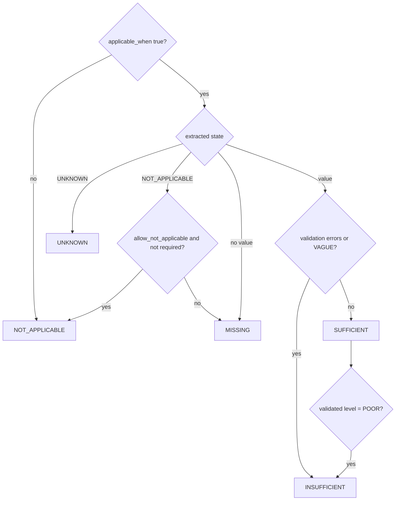

# Deterministic scoring

Two scores in **[0, 100]** are computed by `scoring/engine.py` — pure Python, no model call, no
randomness. Given the same canonical issue, rubric levels, template version and policy version, the
result is bit-for-bit identical. The model only proposes rubric *levels*; Python validates them and does
all arithmetic.

## 1. Field state resolution

For every field of the selected template (`resolve_field`):

`UNKNOWN` means the topic was mentioned but no reliable value exists — including model values whose
evidence could not be verified against the issue text.

## 2. Rubric level validation (`scoring/quality.py::validated_level`)

| Field state | Model level | Validated level |
|---|---|---|
| NOT_APPLICABLE / UNKNOWN | any | none (handled by policy) |
| MISSING | any | ABSENT |
| present | ABSENT | POOR (a value exists) |
| present, validation errors | GOOD / ACCEPTABLE | POOR |
| INSUFFICIENT | GOOD / ACCEPTABLE | POOR |
| summary / description without any operational anchor (policy ≥ `2026.10-2`) | GOOD / ACCEPTABLE | POOR |
| present | not returned by the model | ACCEPTABLE (recorded as a deterministic default) |
| present | other | unchanged |

Every adjustment is stored (`adjusted_from`, `adjustment_reason`).

**Non-specific text.** A summary or description counts as specific when it contains at least one operational
anchor (`domain/services/specificity.py`). Symptoms on their own ("çalışmıyor", "donuyor", "hata var") are not
anchors. The anchors are:

* a number (branch code, time, count, version);
* an error code;
* a quoted message;
* a named device, system or business process (`OBJECT_TERMS`).

From policy `2026.10-2`, a model-proposed GOOD/ACCEPTABLE level for such a field is capped at POOR. This
removes the case where a lenient model gives full credit to "Uygulama çalışmıyor." padded to 12 words (gap
analysis SCO-1, test `tests/unit/test_calibration.py`). The cap only lowers a level, never raises one.

## 3. Scores

For applicable fields *i* with weight *wᵢ* and credit *cᵢ* (fields with credit `None` are excluded from
numerator **and** denominator):

$$\text{score} = 100 \cdot \frac{\sum_i w_i c_i}{\sum_i w_i}$$

rounded to `score_decimals`, clamped to [0, 100]. If the denominator is zero the score is `null`.

| State | Completeness credit | Quality credit |
|---|---|---|
| SUFFICIENT | `sufficient_completeness_credit` (1.0) | `level_credits[level]` |
| INSUFFICIENT | `insufficient_completeness_credit` (1.0) — information is present | `level_credits[level ≤ POOR]` |
| MISSING | 0 | 0 |
| UNKNOWN | policy: `CREDIT` with `unknown_completeness_credit` (0.0) or `EXCLUDE` | policy: `CREDIT` with `unknown_quality_credit` (0.0) or `EXCLUDE` |
| NOT_APPLICABLE | excluded | excluded |

Default `level_credits`: ABSENT 0 · POOR 0.25 · ACCEPTABLE 0.6 · GOOD 1.0.

If the quality assessment step failed, **quality is `null`** (not guessed) while completeness is still
computed; the analysis is `PARTIAL`.

### Worked example

Template fields: summary (w 10), branch_code (20, `^\d{3,5}$`), error_details (30), environment (40).
Issue: summary GOOD, branch_code = "Kadıköy şubesi" (model says GOOD), error_details missing,
environment NOT_APPLICABLE (allowed).

* branch_code fails the pattern → INSUFFICIENT, level clamped to POOR.
* Completeness = 100·(10·1 + 20·1 + 30·0) / (10+20+30) = **50.00**
* Quality = 100·(10·1.0 + 20·0.25 + 30·0) / 60 = **25.00**
* missing_fields = [error_details], insufficient_fields = [branch_code]

## 4. Stored results

Each analysis row stores: `completeness_score`, `quality_score`, `field_scores` (state, weight,
applicable, required, credits, level, validation errors per field), `missing_fields`,
`insufficient_fields`, `unknown_fields`, `missing_required_fields`, `template_id`, `template_version`,
`scoring_policy_version`, `model_id`, `prompt_version`, timestamps. Re-analyses append new rows, giving
the score history shown in the dashboard and used for "quality improvement" analytics.

**UNKNOWN is not MISSING.**

* MISSING means the record does not contain the information. UNKNOWN means it could not be determined:
  the topic is mentioned without a usable value, the extraction step failed, or an unverifiable value was
  downgraded.
* Both get no completeness or quality credit by default, because neither is usable information. They are
  still reported apart:
  * `missing_fields` and `unknown_fields`;
  * the score result's `missing_required_confirmed` and `unknown_required`;
  * the analytics "most missing fields", which counts MISSING and UNKNOWN separately;
  * the `analysis_ready` notification, which shows "Belirlenemeyen zorunlu bilgiler" separately.
* `missing_required_fields` still lists both, because both need a follow-up. It is kept for API
  compatibility.

## 5. Policies

The `scoring` section of the configuration (`ScoringPolicy`). `low_quality_threshold` (default 50) drives
dashboard KPIs and filters.

**Released versions are immutable.** Every released policy is registered verbatim in
`scoring/policies.py::POLICY_HISTORY`.

| Version | Change |
|---|---|
| `2026.10-1` | initial credits |
| `2026.10-2` | non-specific summary/description capped at POOR; credits unchanged |

* A configuration that names a registered version always scores with exactly that version's parameters.
  Parameters it omits are filled from the registry, so pinning `version: "2026.10-1"` keeps the old
  behaviour.
* Startup is refused when a configuration changes any parameter of a registered version.
* A changed policy needs a new version string. A bank-specific string such as `bank-2027.01` is accepted
  as configured.
* `registered_policy(version)` returns the exact policy behind any stored `scoring_policy_version`, so
  historical scores stay explainable.

Weights live in the templates, which are versioned and immutable (see [templates](templates.md)). Neither
weights nor credits have been changed by the calibration work, because a synthetic dataset is not evidence
for a weight change. See [evaluation](evaluation.md#score-calibration) for how to collect that evidence.

Tests: `tests/unit/test_scoring.py` covers each rule above (N/A exclusion, UNKNOWN policies, conditional
applicability/requirement, validation caps, null quality, determinism).
