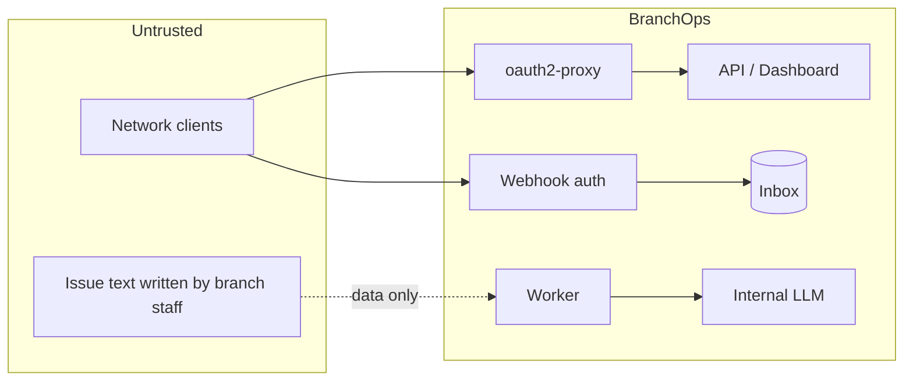

# Security

## Trust boundaries

Jira content is treated as **untrusted data** end to end: it can never become instructions, actions,
scores or credentials.

## Controls

| Requirement | Control | Code / config |
|---|---|---|
| Internal authentication | oauth2-proxy sidecar against the bank OIDC IdP (Keycloak/ADFS); app binds to `127.0.0.1` and trusts `X-Forwarded-User/Groups` only from `security.trusted_proxy_hosts` | `infrastructure/security/auth.py`, `deploy/openshift/base/*.yaml` |
| Role-based authorization | IdP groups → `VIEWER` < `ANALYST` < `ADMIN` (`security.role_groups`); re-analysis requires ANALYST, inbox/replay ADMIN | `api/dependencies`, dashboard `authorize()` |
| Webhook authentication | HMAC-SHA256 of the raw body or header token, constant-time compare, multiple secrets for rotation, optional source CIDR allow-list; URL tokens disabled by default and use a separate secret list | `infrastructure/security/webhook_auth.py` |
| Input validation | content type, streamed size limit, UTF-8 JSON object, issue-key regex, Pydantic models everywhere, bounded query parameters | `api/routes/*`, adapter |
| Prompt-injection defence | data envelope with escaped delimiters, guard-rail system prompt, schema-bound outputs, context validators, evidence verification, no tools, detection flags → `NEEDS_REVIEW`, scores computed in Python | `agents/prompts.py`, `domain/services/prompt_injection.py` |
| Sensitive data masking | TCKN (checksum), IBAN, card numbers (Luhn), phone, e-mail + configurable patterns, applied before storage and before prompting; processed inbox payloads replaced with masked copies | `domain/services/masking.py`, `retention.*` |
| Audit logging | `audit_log` table: issue deletions, re-analysis requests, inbox replays (actor, action, resource, correlation id) | `infrastructure/persistence/audit.py` |
| TLS | Route `reencrypt` + service-serving certificates on the proxy; LLM and PostgreSQL (`sslmode=verify-full`) verified against the internal CA; verification cannot be disabled | `openai_compatible.build_ssl_context`, `database.sslmode` |
| Least privilege | separate ServiceAccounts without token automount; non-root, arbitrary UID, read-only root FS, all capabilities dropped, seccomp `RuntimeDefault`; DB user needs only DML on its schema (DDL only for the migration job) | `deploy/openshift/base` |
| No internet | outbound URL guard (LLM, OTLP) at start-up; default-deny NetworkPolicies with explicit egress to DNS, PostgreSQL, LLM gateway (worker only), SSO, OTel collector; no CDN assets (tested); FastAPI Swagger/ReDoc disabled (they load from a CDN) | `infrastructure/security/network_guard.py`, `tests/unit/test_airgap.py` |
| No shell / no autonomous tools | the codebase contains no subprocess/shell execution; agents have no tools; the LLM has no DB or Jira access and cannot modify Jira; no remediation actions exist | design |
| Secrets hygiene | secrets only via env vars from OpenShift Secrets; config stores env-var **names**; JSON log formatter redacts `token=`, `authorization`, `api_key`, `password`, `secret` patterns; model errors never echo credentials | `infrastructure/observability/logging.py` |
| Response hardening | `X-Content-Type-Options`, `X-Frame-Options: DENY`, `Referrer-Policy`, `Cache-Control: no-store`, restrictive CSP on the API | `api/middleware` |
| MCP server (other teams) | Same proxy/loopback trust as the dashboard; IdP groups → `mcp.teams`; per-team row scope enforced as SQL `WHERE` predicates; per-team tool allow-list (hidden tools are not listed and are rejected); `fields: masked` re-masks free text and hides comment authors; MCP-only team roles (team groups never enter `security.role_groups`); masked teams search with digit/`@` tokens dropped; text truncated; per-principal rate limit; request size limit; every tool call audited; no LLM calls and no raw-SQL tool | `mcp/`, `application/queries/scope.py`, [MCP server](mcp-server.md) |
| Production guard rails | `app.environment: production` refuses `auth_mode: dev`, the mock model provider and non-HTTPS model URLs; `branchops mcp` additionally refuses to start without `mcp.teams` and refuses `--stdio` | `config/settings.py` |

## Residual risks and operator responsibilities

* **Masking is pattern-based.** Free-form personal data (names, addresses) is not detected. Add bank
  specific patterns (`security.masking_extra_patterns`) and train branch staff not to paste customer data.
* **Prompt-injection detection is heuristic**; it is a review trigger, not the defence. A successful
  injection can at worst produce a wrong classification/extraction — still subject to evidence
  verification and never able to trigger actions.
* **Webhook replay**: HMAC does not include a timestamp in Jira's scheme; replays of a captured delivery
  are absorbed by idempotency, and TLS + NetworkPolicy limit capture.
* **oauth2-proxy skip routes** (`/api/webhooks/jira`, `/health/*`, `/metrics`) bypass SSO by design;
  `--skip-auth-strip-headers` removes forged identity headers on them. `/metrics` exposes only
  aggregate counters; restrict scraping with the monitoring NetworkPolicy.
* **MCP clients are outside BranchOps' control.** Data returned to a team's MCP client may be sent to that
  team's model and stored in its chat history. Give each team the narrowest scope and `fields: masked`
  unless it needs full text, and keep `max_text_chars` low. The MCP rate limit is per replica.
* Database encryption at rest, backup policies and log retention follow the bank's PostgreSQL and
  logging platform standards.
* Keep dependencies patched through the internal artifact repository; rebuild the wheelhouse and image
  for security updates (see `openshift-deployment.md`).
