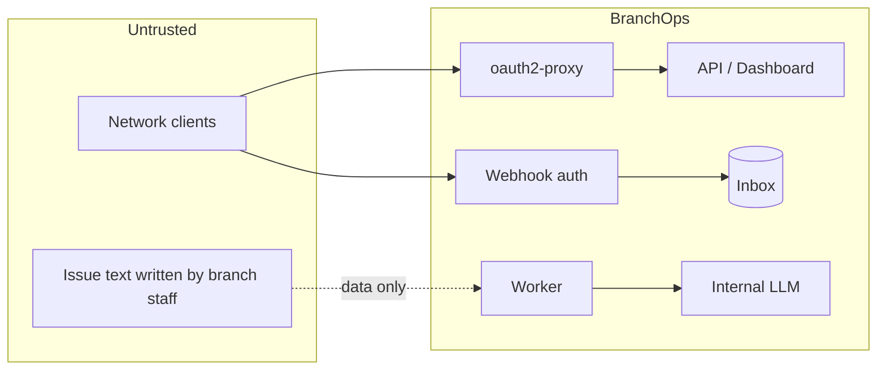
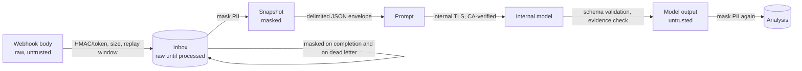

# Security

## Trust boundaries

Jira content is treated as **untrusted data** end to end: it can never become instructions, actions,
scores or credentials.

## Controls

| Requirement | Control | Code / config |
|---|---|---|
| Internal authentication | oauth2-proxy sidecar against the bank OIDC IdP (Keycloak/ADFS); app binds to `127.0.0.1` and trusts `X-Forwarded-User/Groups` only from `security.trusted_proxy_hosts` | `infrastructure/security/auth.py`, `deploy/openshift/base/*.yaml` |
| Role-based authorization | IdP groups → `VIEWER` < `ANALYST` < `ADMIN` (`security.role_groups`); re-analysis requires ANALYST, inbox/replay ADMIN | `api/dependencies`, dashboard `authorize()` |
| Webhook authentication | HMAC-SHA256 of the raw body or header token, constant-time compare, multiple secrets for rotation, optional source CIDR allow-list; URL tokens disabled by default and use a separate secret list | `infrastructure/security/webhook_auth.py` |
| Input validation | content type, streamed size limit, UTF-8 JSON object, issue-key regex, Pydantic models everywhere, bounded query parameters | `api/routes/*`, adapter |
| Prompt-injection defence | data envelope with escaped delimiters, guard-rail system prompt, schema-bound outputs, context validators, evidence verification, no write tools (only the optional `investigate` step has read-only, allow-listed tools), detection flags → `NEEDS_REVIEW`, scores computed in Python | `agents/prompts.py`, `domain/services/prompt_injection.py` |
| Sensitive data masking | TCKN (checksum), IBAN, card numbers (Luhn), phone, e-mail + configurable patterns, applied before storage and before prompting; processed inbox payloads replaced with masked copies | `domain/services/masking.py`, `retention.*` |
| Audit logging | `audit_log` table: issue deletions, re-analysis requests, inbox replays, MCP tool calls, attachment views/downloads, re-routes, notification resends (actor, action, resource, correlation id); every ownership registry write in `ownership_changes` (who, when, before/after) | `infrastructure/persistence/audit.py`, `ownership_repository.py` |
| TLS | Route `reencrypt` + service-serving certificates on the proxy; LLM and PostgreSQL (`sslmode=verify-full`) verified against the internal CA; verification cannot be disabled | `openai_compatible.build_ssl_context`, `database.sslmode` |
| Least privilege | separate ServiceAccounts without token automount; non-root, arbitrary UID, read-only root FS, all capabilities dropped, seccomp `RuntimeDefault`; DB user needs only DML on its schema (DDL only for the migration job) | `deploy/openshift/base` |
| No internet | outbound URL guard (LLM, OTLP, Jira ticketing, S3 attachment store, Zoom egress proxy; SMTP relay host) at start-up; default-deny NetworkPolicies with explicit egress to DNS, PostgreSQL, LLM gateway (worker only), SSO, OTel collector; no CDN assets (tested); FastAPI Swagger/ReDoc disabled (they load from a CDN) | `infrastructure/security/network_guard.py`, `tests/unit/test_airgap.py` |
| No shell / no autonomous tools | the codebase contains no subprocess/shell execution; the only model tools are the `investigate` step's read-only, allow-listed queries (typed arguments, no SQL); the LLM has no direct DB, Jira or notification access; the only external writes are BranchOps' own, deterministic outbox deliveries (Jira tickets for in-app reports, e-mail, Zoom); no remediation actions exist | design |
| Secrets hygiene | secrets only via env vars from OpenShift Secrets; config stores env-var **names**; JSON log formatter redacts `token=`, `authorization`, `api_key`, `password`, `secret` patterns; model errors never echo credentials | `infrastructure/observability/logging.py` |
| Response hardening | `X-Content-Type-Options`, `X-Frame-Options: DENY`, `Referrer-Policy`, `Cache-Control: no-store`, restrictive CSP on the API | `api/middleware` |
| MCP server (other teams) | Same proxy/loopback trust as the dashboard; IdP groups → `mcp.teams`; per-team row scope enforced as SQL `WHERE` predicates; per-team tool allow-list (hidden tools are not listed and are rejected); `fields: masked` re-masks free text and hides comment authors; MCP-only team roles (team groups never enter `security.role_groups`); masked teams search with digit/`@` tokens dropped; text truncated; per-principal rate limit; request size limit; every tool call audited; no LLM calls and no raw-SQL tool | `mcp/`, `application/queries/scope.py`, [MCP server](mcp-server.md) |
| Attachments (screenshots, logs) | classified sensitive; never sent to the LLM; PNG/JPEG/plain text only, magic bytes must match the declared type, `attachments.max_bytes` (3 MB) and `max_per_incident` (5), image pixel limit; images re-encoded with Pillow (EXIF, GPS, ICC and text chunks dropped); client-supplied `blur_regions` pixelated + blurred server-side; text PII-masked; stored separately (bytea or internal S3) and purged after `retention.attachments_days` (plus abandoned draft uploads); viewing and downloading on the dashboard / REST requires VIEWER and is audited; served with `nosniff`, `no-store`, restrictive CSP; upload to an existing incident requires MCP scope on it; forwarded only to the ticket of a reported incident | `application/commands/attachments.py`, `infrastructure/attachments/` |
| In-app context (`app_context`) | all text PII-masked and scanned for prompt injection before storage; query strings/fragments stripped from routes and request paths; host-app usernames pseudonymised with a keyed HMAC (`security.pseudonym_key_env`, `BRANCHOPS_PSEUDONYM_KEY`); stored in `incident_app_context`, used for routing and shown to analysts, **excluded from LLM prompts** (only registry application/screen names reach the analysis) | `domain/services/app_context.py` |
| Outbound notifications and tickets | SMTP relay host and Zoom egress / Jira / S3 URLs must pass the outbound guard; secrets only via env/Secret (configuration holds env-var names, e.g. `zoom_webhook_secret_ref`); messages rendered from masked data; Zoom cards carry no description, PII or screenshot; tickets get masked text only and the `branchops-reported` label (exclude it from the Jira source to avoid re-ingestion); delivery through transactional outboxes with idempotency keys | `infrastructure/notifications/`, `infrastructure/ticketing/`, [ownership and routing](ownership-and-routing.md) |
| Ownership registry | ADMIN-only writes, every change in `ownership_changes`; deterministic routing (no model); route patterns restricted to literal / whole-`{param}` / final `*` segments so matching is linear (no ReDoS); CSV exports neutralise spreadsheet formulas (`=`, `+`, `-`, `@` prefixed with `'`); CSV import all-or-nothing | `domain/entities/ownership.py`, `ownership_repository.py` |
| Production guard rails | `app.environment: production` refuses `auth_mode: dev`, the mock model provider and non-HTTPS model URLs; `branchops mcp` additionally refuses to start without `mcp.teams` and refuses `--stdio`; reporting requires `BRANCHOPS_PSEUDONYM_KEY`; Jira ticketing requires an https `base_url` and token; SMTP requires `smtp_host`, Zoom an https `webhook_base_url`; the worker refuses to start unless the branch operations team exists, is active and has a working channel | `config/settings.py`, `cli.py` |

## AI data flow

| Stage | Control |
|---|---|
| Before the model | Text is masked at normalisation, so the prompt is built from the masked snapshot only. In-app `app_context` and attachments never reach a prompt. |
| Model calls | Every call writes a content-free audit record (`branchops.model_audit` logger): correlation id, agent, schema, model, prompt SHA-256 and size, tokens, latency, finish reason, outcome. Prompts and outputs are never logged. |
| Model output | Schema-bound output and context validators, then evidence verification (quotes of 3 or more characters that occur verbatim). Similarity evidence is checked against the candidate texts too. Investigation findings without verified evidence become `HYPOTHESIS`. Unverified quotes, rationales, recommendations and findings are PII-masked before storage. Reasoning (`<think>`, `reasoning_content`) is discarded. |
| Tools | Only the optional investigation step calls tools. They are allow-listed, read-only and typed, behind a repository port; no SQL comes from the model, and incident keys are limited to surfaced ones. |
| Errors | Stored error text (`webhook_inbox.last_error`, `analyses.errors`, `agent_steps.error`) is PII-masked, and database parameter dumps are cut. API errors return no internals. |
| Scope | Investigation results, which name other incidents, go only to unrestricted callers (dashboard/REST roles), never to team-scoped MCP callers. |
| Retention | Raw payloads are masked after processing *and* on dead letter. Finished inbox events and their workflow checkpoints are deleted after `retention.inbox_days` (dead letters after `inbox_dead_letter_days`). |

Not covered (operator responsibility):

* `analyses`, `agent_steps`, `audit_log` and outbox rows have no automatic retention yet. Define
  partition/archive jobs according to the bank's retention policy.
* Free-form personal data (names, addresses) is not detected by the pattern-based masker.

## Residual risks and operator responsibilities

* **Masking is pattern-based.** Free-form personal data (names, addresses) is not detected. Add bank
  specific patterns (`security.masking_extra_patterns`) and train branch staff not to paste customer data.
* **Prompt-injection detection is heuristic**; it is a review trigger, not the defence. A successful
  injection can at worst produce a wrong classification/extraction — still subject to evidence
  verification and never able to trigger actions.
* **Webhook replay**: HMAC does not include a timestamp in Jira's scheme; replays of a captured delivery
  are absorbed by idempotency, and TLS + NetworkPolicy limit capture.
* **oauth2-proxy skip routes** (`POST /api/ingest/{source}`, `POST /api/webhooks/jira`, `/health/*`,
  `/metrics`) bypass SSO by design; `--skip-auth-strip-headers` removes forged identity headers on them.
  The ingest endpoints are protected by per-source HMAC/token authentication (and the optional CIDR
  allow-list), not by SSO: Jira and ServiceNow cannot sign in. Unknown or disabled sources return `404`. `/metrics` exposes only
  aggregate counters; restrict scraping with the monitoring NetworkPolicy.
* **MCP clients are outside BranchOps' control.** Data returned to a team's MCP client may be sent to that
  team's model and stored in its chat history. Give each team the narrowest scope and `fields: masked`
  unless it needs full text, and keep `max_text_chars` low. The MCP rate limit is per replica.
* **Screenshots can contain customer data that blur regions missed.** Embedded agents must detect and
  blur customer data before upload (the `report-from-app` prompt asks for it); keep retention short and
  restrict dashboard access. Attachment and app-context access on the dashboard/REST is VIEWER-wide, not
  team-scoped.
* **E-mail and Zoom leave the BranchOps trust boundary.** Messages are masked, but summaries are free text
  written by branch staff; Zoom cards deliberately omit descriptions.
* **Ticket delivery is at-least-once**: if Jira accepts a ticket but the outbox update fails, a retry can
  create a duplicate ticket.
* Database encryption at rest, backup policies and log retention follow the bank's PostgreSQL and
  logging platform standards.
* Keep dependencies patched through the internal artifact repository; rebuild the wheelhouse and image
  for security updates (see `openshift-deployment.md`).
